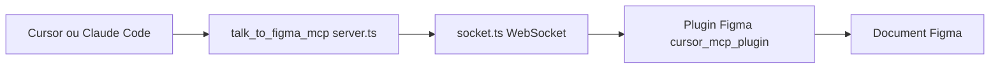

# sonnylazuardi/cursor-talk-to-figma-mcp

> Connects Cursor or Claude Code to Figma through MCP to read and modify designs.

## The problem
A coding agent cannot see Figma mockups and cannot modify them in bulk.

## What it actually does
A TypeScript MCP server exposes Figma tools (reading the selection, creating frames and text, styles, auto layout, components, image export, annotations, FigJam connectors). A WebSocket server links the MCP server to a Figma plugin installed in development mode. Bulk text replacement and propagation of instance overrides.

## How it is wired


## Trying it
```bash
curl -fsSL https://bun.sh/install | bash
bun setup
bun socket
```

## Cost and gotchas
Free; requires Bun, a Figma account, the locally linked plugin and a `join_channel` channel before any command. Under WSL, you must uncomment `hostname: "0.0.0.0"` in `src/socket.ts`.

## What it is not
Not a data tool: it acts on mockups, and image export is limited (base64 as text). Commands can throw exceptions.

## Alternatives
No alternative named in the README.

## For you
Ignore: outside the data/AI/MLOps profile, only useful if you do agent-driven front-end work.
