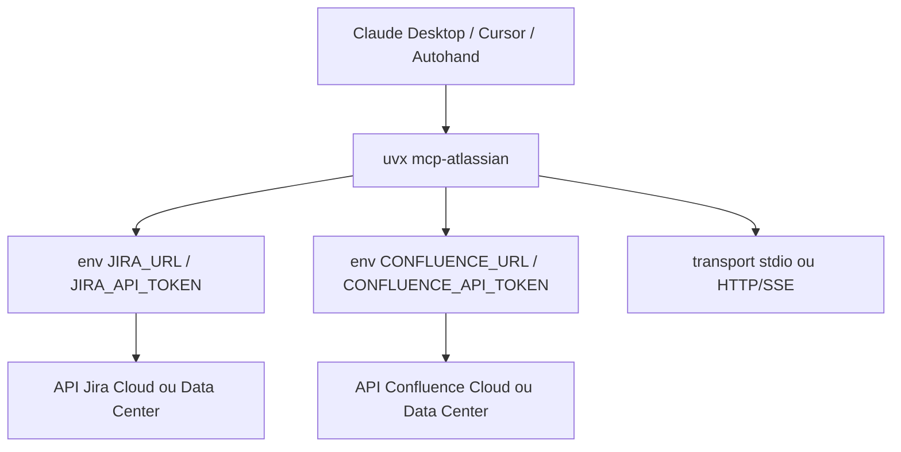

# sooperset/mcp-atlassian

> MCP server giving an assistant read-write access to Jira and Confluence.

## The problem
Tickets and documentation live in Atlassian, the coding assistant lives elsewhere: context gets copied by hand.
Creating a bug, changing a status or looking for an onboarding page always means leaving the tool.

## What it actually does
It exposes 98 MCP tools covering Jira and Confluence, including `jira_search` (JQL), `jira_create_issue`, `jira_transition_issue`, `confluence_search` (CQL), `confluence_create_page` and `confluence_add_comment`.
It works on Cloud as well as Server/Data Center — Confluence v6.0+, Jira v8.14+ — with an API token for the former, a Personal Access Token for the latter.
Authentication also covers OAuth 2.0, and the HTTP transport offers SSE, streamable-http and a multi-user mode.
The documentation is published as `llms.txt` and `llms-full.txt`, directly consumable by a model.

## How it is wired


## Trying it
```bash
# configuration MCP : command "uvx", args ["mcp-atlassian"],
# env JIRA_URL / JIRA_USERNAME / JIRA_API_TOKEN / CONFLUENCE_*
autohand mcp add mcp-atlassian env \
  JIRA_URL=https://your-company.atlassian.net \
  JIRA_USERNAME=your.email@company.com \
  JIRA_API_TOKEN=your_api_token \
  uvx mcp-atlassian
```
The token is created at `https://id.atlassian.com/manage-profile/security/api-tokens`.

## Cost and gotchas
The server is free; you need an Atlassian account and an API token in plain text in the MCP configuration or a `.env`, which the README explicitly asks you to protect.
On Server/Data Center, it is `JIRA_PERSONAL_TOKEN` and not the username + token pair — a classic mistake on the first try.

## What it is not
It is not a read-only connector: the assistant can create tickets and edit pages with your permissions.
It is not an official Atlassian integration, and the README declares no license.

## Alternatives
No alternative is named in the README.

## For you
The obvious shortcut if your team lives in Jira: your agent reads the tickets without you doing the copy-paste.
