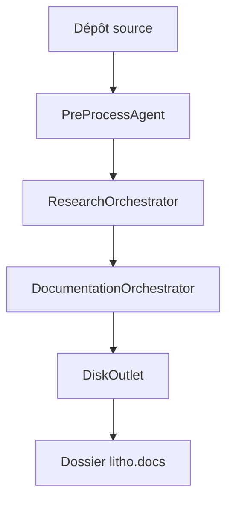

# sopaco/deepwiki-rs

> Rust generator of C4-format architecture documentation from a repository, using an LLM.

## The problem
Architecture documentation goes stale as soon as the code changes, and nobody rewrites it.

## What it actually does
A four-stage pipeline: code preprocessing (structure, dependencies), agent-based research (system context, modules, workflows), document writing, then verification of the Mermaid diagrams. LLM calls go through a cache. It can also document SQL schemas and integrate external documents. The README states that Litho has evolved into a project named Terrain.

## How it is wired


## Trying it
```bash
cargo install deepwiki-rs
deepwiki-rs -p ./my-project -o ./docs
deepwiki-rs --target-language en -p ./my-project
```

## Cost and gotchas
You must provide the key and URL of an LLM provider, billing at your expense. Rust 1.70 or later. Agents with tools may send search queries to the Parallel Search MCP service; can be disabled with `disable_web_search = true`.

## What it is not
Not a tool that guarantees accurate documents: the content is produced by a model. The README gives no measured quality figure.

## Alternatives
Not documented in the README, except the Terrain project (announced successor).

## For you
Keep an eye on it: handy to map an unfamiliar repository, but you must proofread the LLM output, and the author is already pointing toward Terrain.
