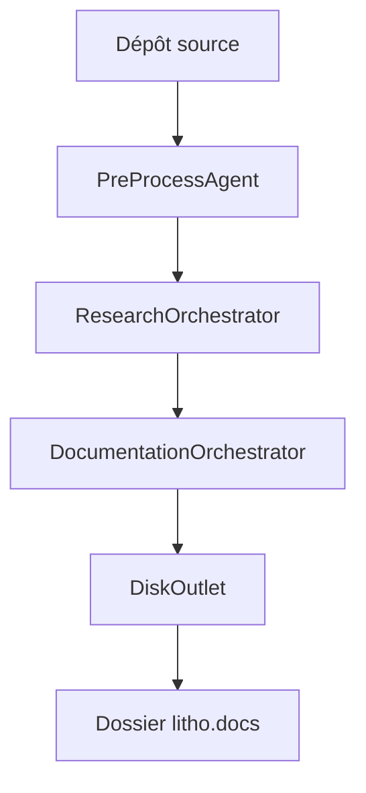

# sopaco/deepwiki-rs

> Générateur en Rust de documentation d'architecture au format C4 à partir d'un dépôt, via un LLM.

## Le problème
La documentation d'architecture se périme dès que le code change, et personne ne la réécrit.

## Ce que ça fait vraiment
Un pipeline en quatre étapes : prétraitement du code (structure, dépendances), recherche par agents (contexte système, modules, workflows), rédaction de documents, puis vérification des diagrammes Mermaid. Les appels au LLM passent par un cache. Il sait aussi documenter des schémas SQL et intégrer des documents externes. Le README annonce que Litho a évolué en un projet nommé Terrain.

## Comment c'est branché


## Essayer
```bash
cargo install deepwiki-rs
deepwiki-rs -p ./my-project -o ./docs
deepwiki-rs --target-language en -p ./my-project
```

## Coût et pièges
Clé et URL d'un fournisseur LLM à renseigner, facturation à ta charge. Rust 1.70 ou plus. Les agents avec outils peuvent envoyer des requêtes de recherche au service MCP Parallel Search ; désactivable avec `disable_web_search = true`.

## Ce que ce n'est pas
Pas un outil garantissant des documents exacts : le contenu est produit par un modèle. Le README ne chiffre aucune qualité mesurée.

## Alternatives
Non documenté dans le README, sauf le projet Terrain (successeur annoncé).

## Pour toi
À surveiller : pratique pour cartographier un dépôt inconnu, mais il faut relire la sortie du LLM, et l'auteur oriente déjà vers Terrain.

