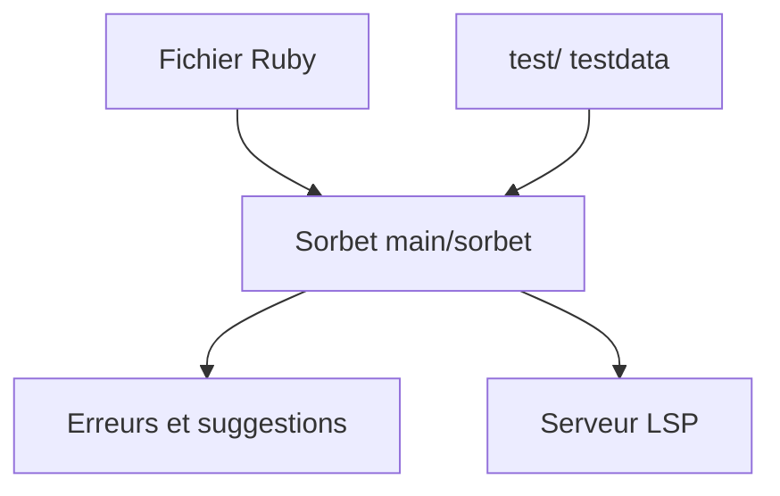

# sorbet/sorbet

> Fast, gradually typed type checker for Ruby; this README targets contributors.

## The problem
Large Ruby codebases lack type guarantees without changing the language's syntax.

## What it actually does
Sorbet checks annotations written in existing Ruby syntax, explicit, concise and adoptable gradually. The README mostly describes how to build it with Bazel, run it on an expression or a file, and write tests: test corpus, expectation tests, CLI, LSP (definition, hover, completion, rename) and fast or slow incremental checking. It is truncated before the end.

## How it is wired
Simplified diagram based on the sheet, no diagram provided.


## Trying it
```bash
brew install bazel autoconf coreutils parallel
git clone https://github.com/sorbet/sorbet.git
cd sorbet
./bazel build //main:sorbet --config=dbg
bazel-bin/main/sorbet -e "42 + 'hello'"
bazel test //... --config=dbg
```

## Cost and gotchas
Free, Apache-2.0. Built from source with Bazel: slow and sensitive to Xcode versions on macOS. 1,006 open issues. Part of the text is aimed at Stripe's internal teams.

## What it is not
This README is not a usage guide for Ruby developers: it points to the public documentation and the online sandbox. It does not concern Python.

## Alternatives
No alternative named in the README.

## For you
Ignore: a type checker for Ruby, outside the data, AI or MLOps scope, unless you maintain Ruby code.
