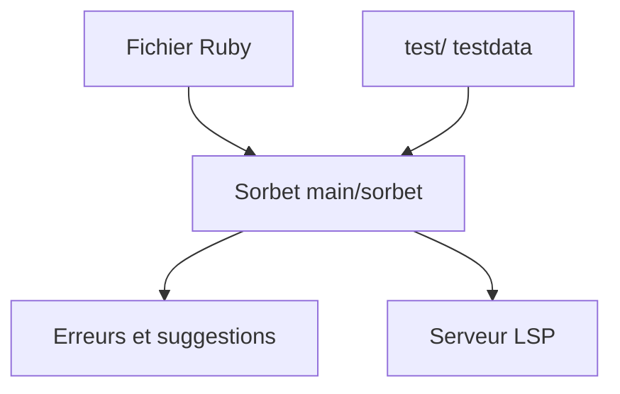

# sorbet/sorbet

> Vérificateur de types rapide pour Ruby, à typage progressif ; ce README vise les contributeurs.

## Le problème
Les grandes bases de code Ruby manquent de garanties de types sans changer la syntaxe du langage.

## Ce que ça fait vraiment
Sorbet vérifie des annotations écrites en syntaxe Ruby existante, de façon explicite, concise et adoptable progressivement. Le README décrit surtout comment le compiler avec Bazel, le lancer sur une expression ou un fichier, et écrire des tests : corpus de tests, tests d'attentes, CLI, LSP (définition, survol, complétion, renommage) et vérification incrémentale rapide ou lente. Il est tronqué avant la fin.

## Comment c'est branché
Schéma simplifié d'après la fiche, sans diagramme fourni.


## Essayer
```bash
brew install bazel autoconf coreutils parallel
git clone https://github.com/sorbet/sorbet.git
cd sorbet
./bazel build //main:sorbet --config=dbg
bazel-bin/main/sorbet -e "42 + 'hello'"
bazel test //... --config=dbg
```

## Coût et pièges
Gratuit, Apache-2.0. Compilation depuis les sources avec Bazel : longue et sensible aux versions de Xcode sous macOS. 1 006 issues ouvertes. Une partie du texte vise les équipes internes de Stripe.

## Ce que ce n'est pas
Ce README n'est pas un guide d'usage pour développeurs Ruby : il renvoie à la documentation publique et au bac à sable en ligne. Il ne concerne pas Python.

## Alternatives
Aucune alternative nommée dans le README.

## Pour toi
À ignorer : vérificateur de types pour Ruby, hors du périmètre data, IA ou MLOps, sauf si tu maintiens du code Ruby.

