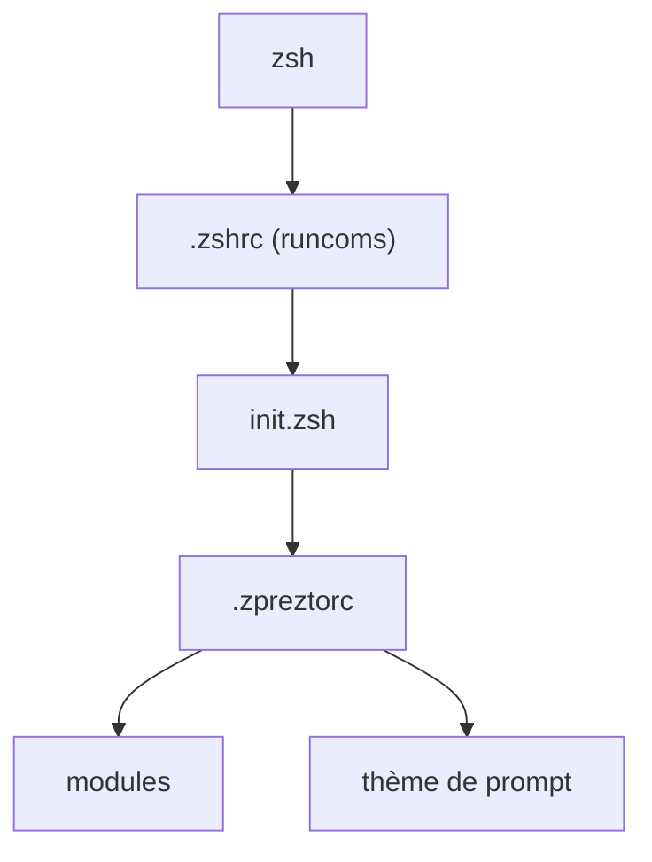

# sorin-ionescu/prezto

> Configuration framework for Zsh: aliases, functions, completion and prompt themes, for those who live in the terminal.

## The problem
A bare Zsh takes hours of tweaking to get pleasant completion, aliases and a prompt.

## What it actually does
Provides a modular Zsh configuration: you clone the repository into `~/.zprezto`, link the `runcoms` files, then enable the modules you want in `.zpreztorc`. Several features are disabled by default. It offers prompt themes (`prompt -l`), external modules and updating via `zprezto-update`.

## How it is wired


## Trying it
```bash
git clone --recursive https://github.com/sorin-ionescu/prezto.git "${ZDOTDIR:-$HOME}/.zprezto"
chsh -s /bin/zsh
zprezto-update
prompt -l
```

## Cost and gotchas
Free. If you already have Zsh configuration files, the `ln` links fail: back them up first. Zsh 4.3.11 minimum.

## What it is not
Not a shell: it assumes Zsh is installed. It is not active by default; you have to choose your modules.

## Alternatives
- No alternative named in the README.

## For you
Keep an eye on it: comfortable if you spend your days in a Zsh terminal, but purely ergonomic and unrelated to data or AI.
