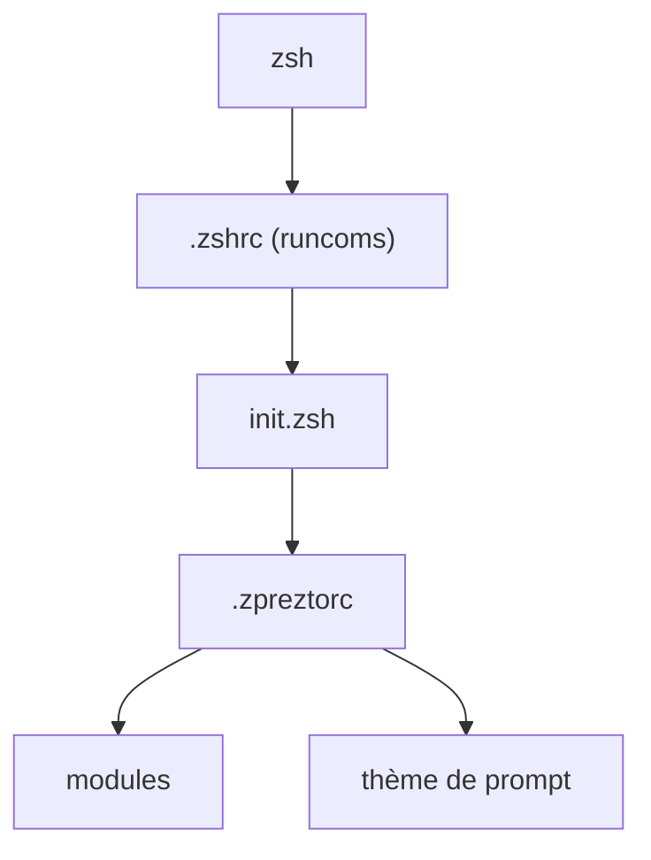

# sorin-ionescu/prezto

> Cadre de configuration pour Zsh : alias, fonctions, complétion et thèmes de prompt, pour qui vit en terminal.

## Le problème
Un Zsh nu demande des heures de réglages pour obtenir une complétion, des alias et un prompt agréables.

## Ce que ça fait vraiment
Fournit une configuration Zsh modulaire : on clone le dépôt dans `~/.zprezto`, on lie les fichiers `runcoms`, puis on active les modules voulus dans `.zpreztorc`. Plusieurs fonctions sont désactivées par défaut. Il propose des thèmes de prompt (`prompt -l`), des modules externes et une mise à jour via `zprezto-update`.

## Comment c'est branché


## Essayer
```bash
git clone --recursive https://github.com/sorin-ionescu/prezto.git "${ZDOTDIR:-$HOME}/.zprezto"
chsh -s /bin/zsh
zprezto-update
prompt -l
```

## Coût et pièges
Gratuit. Si tu as déjà des fichiers de configuration Zsh, les liens `ln` échouent : sauvegarde-les d'abord. Zsh 4.3.11 minimum.

## Ce que ce n'est pas
Pas un shell : il suppose que Zsh est installé. Ce n'est pas un outil actif par défaut, il faut choisir ses modules.

## Alternatives
- Aucune alternative nommée dans le README.

## Pour toi
À surveiller : confortable si tu passes tes journées en terminal Zsh, mais purement ergonomique et sans lien avec la data ou l'IA.

