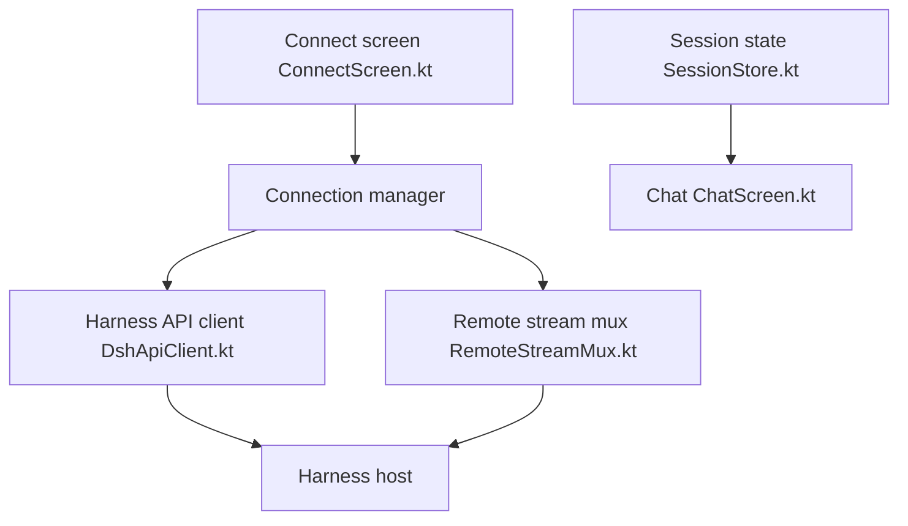

# sorsama/deepseek-harness-mobile

> Unofficial Android app to drive a DeepSeek Harness coding agent from a phone.

## The problem
A coding agent runs on a computer; following it, answering its questions and approving its commands remotely requires a mobile interface.

## What it actually does
Native Android client for the DeepSeek Harness: streaming chat, tool-call trajectory, sub-agents, plan, goals, background tasks, terminal, file preview and notifications. Connection over the local network, through an encrypted relay (dsh-relay plugin) or via a harness running inside the app itself (beta, `proot`, about 1.1 GB). Agent commands can ask for confirmation ("Ask me first").

## How it is wired



## Trying it
```bash
dsh web --host 192.168.1.20
./gradlew :app:assembleDebug
./gradlew :core:jvmTest :app:testDebugUnitTest
```

## Cost and gotchas
Free; a model provider with an API key is required for the embedded harness. A connected phone can do everything the agent can: treat the connection link as shell access. Local network mode is not encrypted.

## What it is not
Not an agent or a model: a client for an existing harness. Unofficial, and the embedded harness is in beta, tested on emulators and a single Samsung phone.

## Alternatives
sorsama/deepseek-harness-relay: relay plugin for access away from home, in a separate repo.

## For you
Ignore unless you use DeepSeek Harness: a very specific mobile companion, of no value for a data or MLOps workflow.
