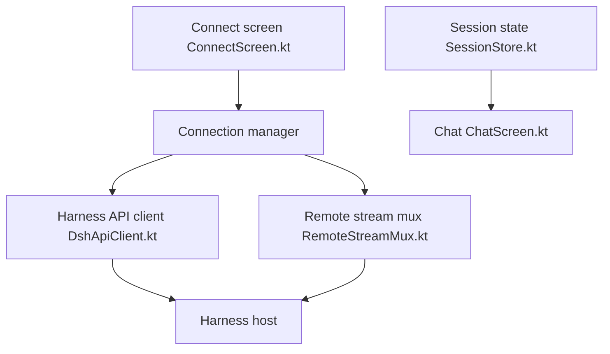

# sorsama/deepseek-harness-mobile

> Application Android non officielle pour piloter depuis un téléphone un agent de code DeepSeek Harness.

## Le problème
Un agent de code tourne sur un ordinateur ; le suivre, répondre à ses questions et approuver ses commandes à distance demande une interface mobile.

## Ce que ça fait vraiment
Client Android natif du DeepSeek Harness : chat en streaming, trajectoire des appels d'outils, sous-agents, plan, objectifs, tâches en arrière-plan, terminal, aperçu de fichiers et notifications. Connexion en réseau local, par relais chiffré (plugin dsh-relay) ou via un harness exécuté dans l'app elle-même (bêta, `proot`, environ 1,1 Go). Les commandes de l'agent peuvent demander validation (« Ask me first »).

## Comment c'est branché



## Essayer
```bash
dsh web --host 192.168.1.20
./gradlew :app:assembleDebug
./gradlew :core:jvmTest :app:testDebugUnitTest
```

## Coût et pièges
Gratuit ; un fournisseur de modèle avec clé d'API est requis pour le harness embarqué. Un téléphone connecté peut tout faire comme l'agent : traite le lien de connexion comme un accès shell. Le mode réseau local n'est pas chiffré.

## Ce que ce n'est pas
Pas un agent ni un modèle : un client d'un harness existant. Non officiel, et le harness embarqué est en bêta, testé sur émulateurs et un seul téléphone Samsung.

## Alternatives
sorsama/deepseek-harness-relay : plugin de relais pour l'accès hors du domicile, dans un dépôt séparé.

## Pour toi
À ignorer sauf usage de DeepSeek Harness : compagnon mobile très spécifique, sans valeur pour un workflow data ou MLOps.

