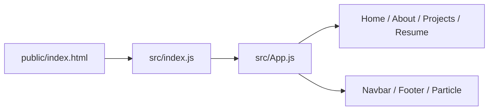

# soumyajit4419/Portfolio

> Personal portfolio site in React, to fork and customize, with credit requested for the author.

## The problem
Quickly building a showcase site with an introduction, projects and a CV.

## What it actually does
Multi-page React application (Home, About, Projects, Resume) with React-Bootstrap and customizable CSS. You edit the components in `/src/components/` to put in your own information. The README mentions Node/Express, but the file tree is entirely client-side; deployment via Vercel.

## How it is wired


## Trying it
```bash
npm install
npm start
```

## Cost and gotchas
Free. No license declared: the right to reuse it is unclear despite the invitation to fork. The README is very short.

## What it is not
Not a portfolio framework: it is the author's personal site, to be emptied of their data.

## Alternatives
None named in the README.

## For you
Ignore: a web template unrelated to your field, and without a clear license.
