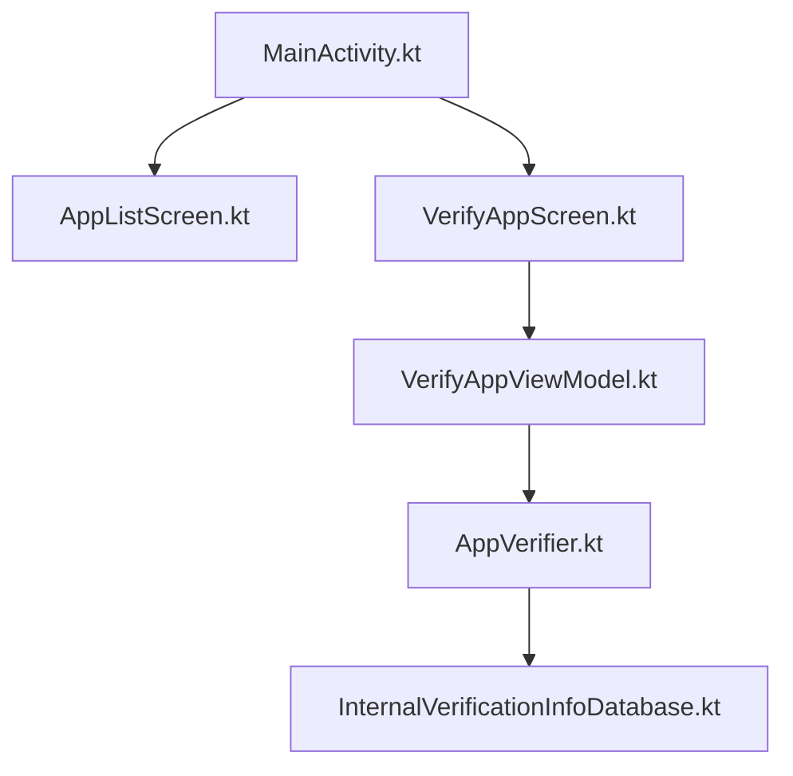

# soupslurpr/AppVerifier

> Android app that compares an app's signing certificate fingerprint to the expected one.

## The problem
It is hard to make sure an installed Android application is authentic and unmodified.

## What it actually does
Takes the package name and the SHA-256 fingerprints of the certificates and compares them to those you provide or to an internal database (rules in INTERNAL_DATABASE_CRITERIA.md). You can share and receive verification information. App list screen, verification screen, Compose ViewModel.

## How it is wired


## Trying it
```bash
apksigner verify --print-certs AppVerifier-X.Y.Z.apk
```

## Cost and gotchas
Free. Distributed via Accrescent (recommended) or GitHub. Do not use it to verify itself, nor to verify Accrescent if it comes from there.

## What it is not
Not an antivirus nor a malware detector: it only proves that the signature matches.

## Alternatives
No alternative named in the README.

## For you
Ignore: Android signature verification tool unrelated to data, AI or MLOps work.
