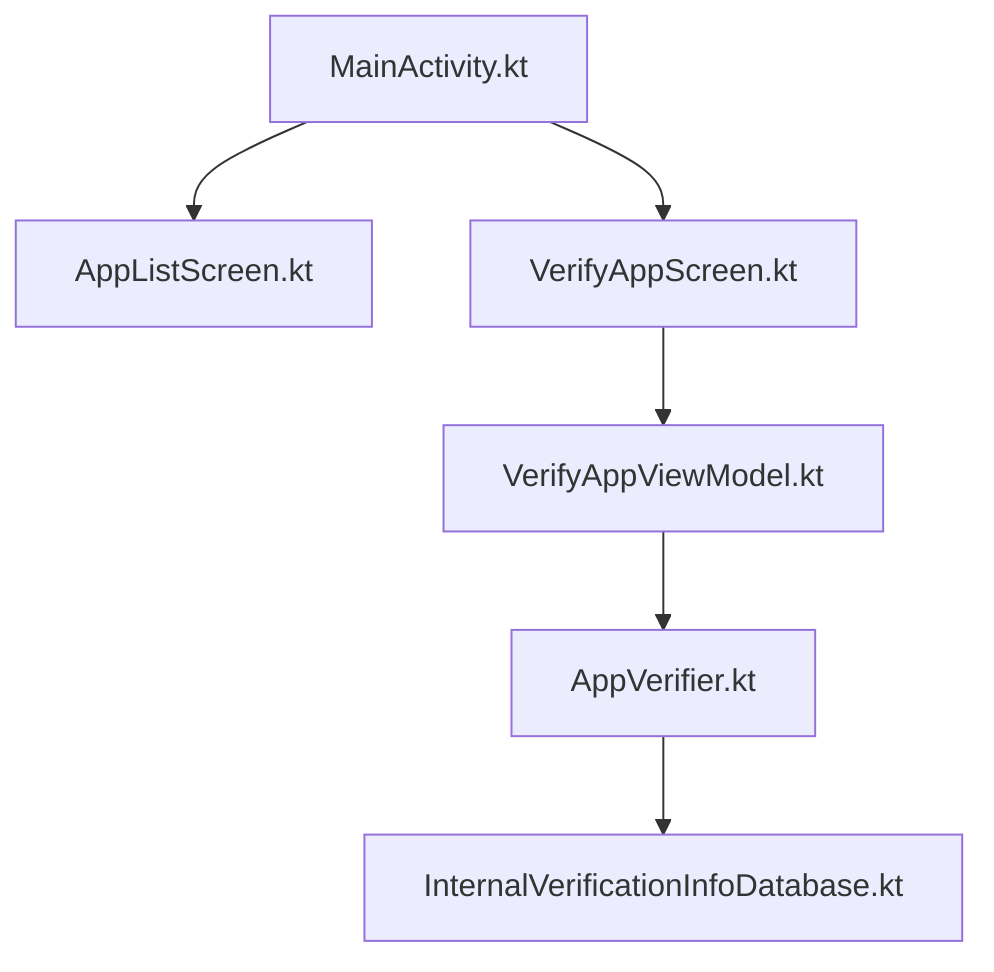

# soupslurpr/AppVerifier

> Application Android qui compare l'empreinte du certificat de signature d'une app à celle attendue.

## Le problème
Il est difficile de s'assurer qu'une application Android installée est authentique et non modifiée.

## Ce que ça fait vraiment
Prend le nom de paquet et les empreintes SHA-256 des certificats et les compare à celles fournies par toi ou à une base interne (règles dans INTERNAL_DATABASE_CRITERIA.md). Tu peux partager et recevoir des informations de vérification. Écran de liste d'apps, écran de vérification, ViewModel Compose.

## Comment c'est branché


## Essayer
```bash
apksigner verify --print-certs AppVerifier-X.Y.Z.apk
```

## Coût et pièges
Gratuit. Distribution via Accrescent (recommandé) ou GitHub. Ne pas l'utiliser pour se vérifier lui-même ni pour vérifier Accrescent s'il en vient.

## Ce que ce n'est pas
Pas un antivirus ni un détecteur de malware : il ne prouve que la correspondance de signature.

## Alternatives
Aucune alternative nommée dans le README.

## Pour toi
À ignorer : outil Android de vérification de signatures sans lien avec le travail data, IA ou MLOps.

