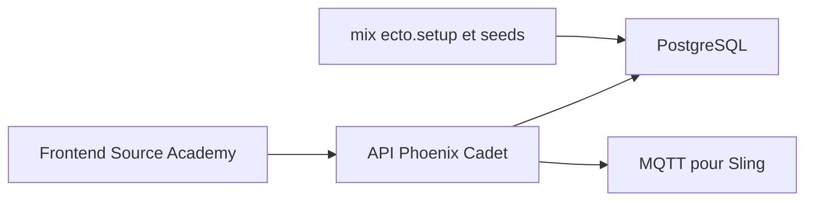

# source-academy/backend

> Elixir Phoenix backend, named Cadet, of the Source Academy programming learning platform.

## The problem
Source Academy needs an API to manage assessments, submissions and students of its platform.

## What it actually does
Serves the web application's API, with a PostgreSQL database pre-filled in development (10 students, 5 assessments). The `mix cadet.token <role>` command provides a test JWT token. An MQTT part is needed for remote execution with Sling. The `master` (unstable) and `stable` branches are distinct.

## How it is wired
Simplified diagram based on the sheet, no diagram provided.



## Trying it
```bash
cp config/dev.secrets.exs.example config/dev.secrets.exs
mix deps.get
mix ecto.setup
mix phx.server
```

## Cost and gotchas
Free. Requires Elixir 1.19+, Erlang/OTP 28+ and PostgreSQL 12+ (Docker offered for the database). The `master` branch may not work with the frontend.

## What it is not
Not a platform usable on its own: you need the frontend. Not a general-purpose LMS.

## Alternatives
No alternative named in the README.

## For you
Ignore: backend of a specific educational platform, with no relevance for a data, AI or MLOps profile.
