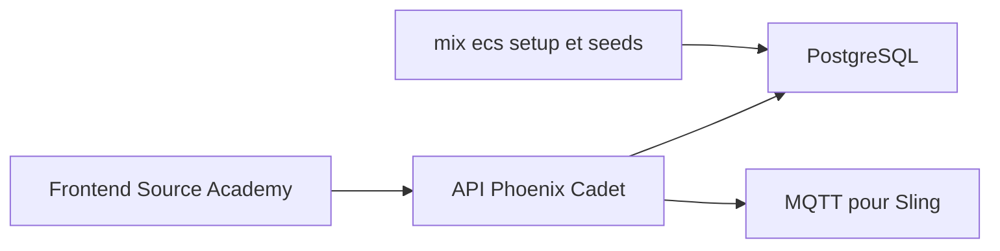

# source-academy/backend

> Backend Elixir Phoenix, nommé Cadet, de la plateforme d'apprentissage de la programmation Source Academy.

## Le problème
Source Academy a besoin d'une API pour gérer évaluations, soumissions et étudiants de sa plateforme.

## Ce que ça fait vraiment
Sert l'API de l'application web, avec une base PostgreSQL pré-remplie en développement (10 étudiants, 5 évaluations). La commande `mix cadet.token <role>` fournit un jeton JWT d'essai. Une partie MQTT est nécessaire pour l'exécution distante avec Sling. Les branches `master` (instable) et `stable` sont distinctes.

## Comment c'est branché
Schéma simplifié d'après la fiche, sans diagramme fourni.



## Essayer
```bash
cp config/dev.secrets.exs.example config/dev.secrets.exs
mix deps.get
mix ecto.setup
mix phx.server
```

## Coût et pièges
Gratuit. Demande Elixir 1.19+, Erlang/OTP 28+ et PostgreSQL 12+ (Docker proposé pour la base). La branche `master` peut ne pas fonctionner avec le frontend.

## Ce que ce n'est pas
Pas une plateforme utilisable seule : il faut le frontend. Ce n'est pas un LMS généraliste.

## Alternatives
Aucune alternative nommée dans le README.

## Pour toi
À ignorer : backend d'une plateforme éducative spécifique, sans portée pour un profil data, IA ou MLOps.

