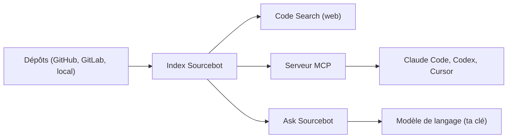

# sourcebot-dev/sourcebot

> Self-hosted code context layer: indexes your repositories for search, for humans and for agents.

## The problem
Agents and teams only see locally cloned repositories: finding the callers of an API in other services is slow.

## What it actually does
Indexes GitHub, GitLab, Bitbucket, Azure DevOps or local repositories, with regex and boolean search. Exposes an MCP server (search, file reading, symbol definitions and references). "Ask Sourcebot" answers questions about the code through a language model that you configure with your key. Permissions from the code host are synchronized.

## How it is wired
Simplified diagram based on the sheet, no diagram provided.



## Trying it
```sh
npx setup-sourcebot
```

## Cost and gotchas
Requires Node.js (24 LTS recommended), Docker and Docker Compose. Ask uses your own model key; paid plans exist (pricing page).

## What it is not
It is not a full code assistant: it is an index and a query layer. Code sent to Ask goes to the model provider you choose.

## Alternatives
No alternative named in the README.

## For you
Adopt it to give your agents MCP access to all your indexed code: a real gain when repositories are numerous.
