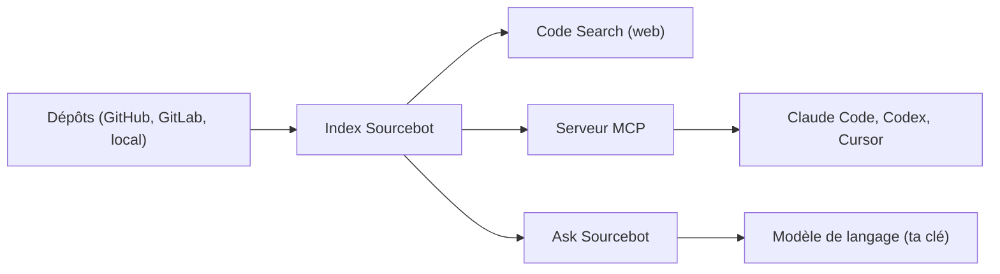

# sourcebot-dev/sourcebot

> Couche de contexte de code auto-hébergée : indexe vos dépôts pour la recherche, les humains et les agents.

## Le problème
Les agents et les équipes ne voient que les dépôts clonés localement : trouver les appelants d'une API dans d'autres services est lent.

## Ce que ça fait vraiment
Indexe des dépôts GitHub, GitLab, Bitbucket, Azure DevOps ou locaux, avec recherche par regex et booléens. Expose un serveur MCP (recherche, lecture de fichiers, définitions et références de symboles). « Ask Sourcebot » répond aux questions sur le code via un modèle de langage que tu configures avec ta clé. Les permissions de l'hébergeur de code sont synchronisées.

## Comment c'est branché
Schéma simplifié d'après la fiche, sans diagramme fourni.



## Essayer
```sh
npx setup-sourcebot
```

## Coût et pièges
Il faut Node.js (24 LTS recommandé), Docker et Docker Compose. Ask utilise ta propre clé de modèle ; des plans payants existent (page de tarifs).

## Ce que ce n'est pas
Ce n'est pas un assistant de code complet : c'est un index et une couche de requête. Le code envoyé à Ask part chez le fournisseur de modèle que tu choisis.

## Alternatives
Aucune alternative nommée dans le README.

## Pour toi
À adopter pour donner à tes agents un accès MCP à tout ton code indexé : un gain réel quand les dépôts sont nombreux.

