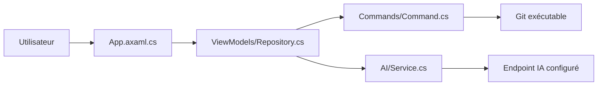

# sourcegit-scm/sourcegit

> Open-source, cross-platform graphical Git client, for those who prefer an interface to commands.

## The problem
Advanced Git operations (interactive rebase, bisect, LFS, worktrees) are painful on the command line for many users.

## What it actually does
Avalonia desktop application (Windows, macOS, Linux): commit graph, image diff, blame, GitFlow, LFS, workspaces, custom actions. Optional: commit messages generated by an OpenAI-compatible service (or Ollama locally). It relies on the installed Git executable (≥ 2.25.1).

## How it is wired


## Trying it
```bash
scoop bucket add extras
scoop install sourcegit
brew install --cask sourcegit
```

## Cost and gotchas
Free; the AI feature requires an API key at your expense or a local model. macOS packages are unsigned; on Linux, tested on Debian 12 only.

## What it is not
Not a host nor a replacement for Git: it drives Git. The apt/rpm repositories mentioned are maintained by third parties.

## Alternatives
No alternative named in the README.

## For you
Watch: handy for visualizing histories and experiment branches, but nothing essential compared to your current Git client.
