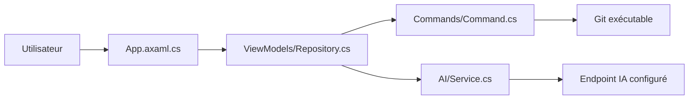

# sourcegit-scm/sourcegit

> Client Git graphique open source et multiplateforme, pour qui préfère une interface aux commandes.

## Le problème
Les opérations Git avancées (rebase interactif, bisect, LFS, worktrees) sont pénibles en ligne de commande pour beaucoup d'utilisateurs.

## Ce que ça fait vraiment
Application de bureau Avalonia (Windows, macOS, Linux) : graphe de commits, diff d'images, blame, GitFlow, LFS, espaces de travail, actions personnalisées. Optionnel : messages de commit générés par un service compatible OpenAI (ou Ollama en local). Elle s'appuie sur l'exécutable Git installé (≥ 2.25.1).

## Comment c'est branché


## Essayer
```bash
scoop bucket add extras
scoop install sourcegit
brew install --cask sourcegit
```

## Coût et pièges
Gratuit ; la fonction IA exige une clé d'API à ta charge ou un modèle local. Paquets macOS non signés ; côté Linux, testé sur Debian 12 seulement.

## Ce que ce n'est pas
Pas un hébergeur ni un remplaçant de Git : il pilote Git. Les dépôts apt/rpm cités sont tenus par des tiers.

## Alternatives
Aucune alternative nommée dans le README.

## Pour toi
À surveiller : pratique pour visualiser historiques et branches d'expériences, mais rien d'indispensable face à ton client Git actuel.

