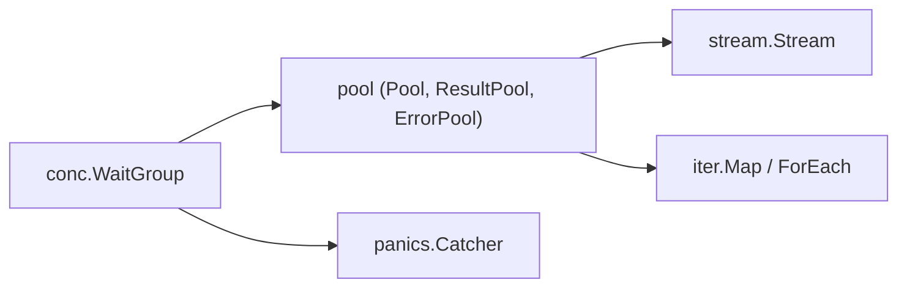

# sourcegraph/conc

> Go structured concurrency library: pools, ordered streams and panic recovery.

## The problem
Launching goroutines without waiting for them makes them leak, and a panic in one crashes the whole process.

## What it actually does
A safe `conc.WaitGroup`, which propagates panics with the child goroutine's stack at `Wait()` time. Pools (`pool.New`, with result, error and context variants), `stream.Stream` to process in parallel while keeping order, `iter.Map` and `iter.ForEach` to iterate over slices, and `panics.Catcher`.

## How it is wired


## Trying it
```bash
go get github.com/sourcegraph/conc
```

## Cost and gotchas
Free. The README announces a pre-1.0 version with 1.0 targeted for March 2023: it has not been updated since, so the real stability status needs checking.

## What it is not
Not an orchestration framework: it is a small toolbox around `sync.WaitGroup` and channels. It does not replace messaging libraries.

## Alternatives
No alternative named in the README (it only compares itself with the standard library).

## For you
Ignore unless you write concurrent Go: nothing for Python data/AI, and its original README is no longer up to date.
