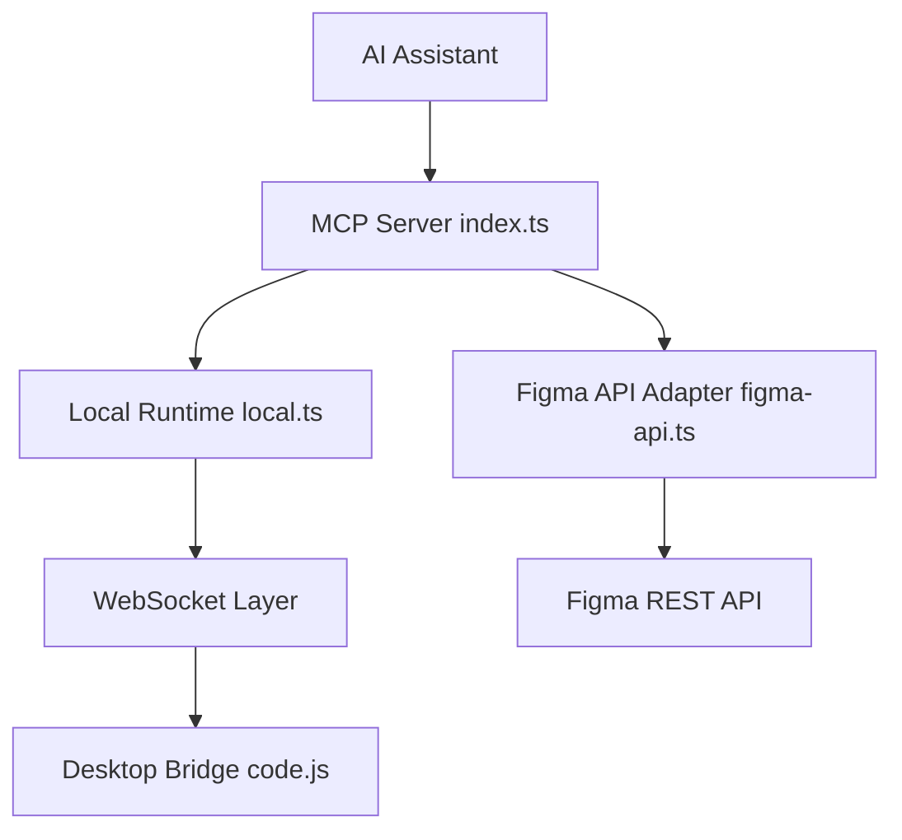

# southleft/figma-console-mcp

> MCP server that lets an AI assistant read and modify Figma, synchronize tokens and audit a design system.

## The problem
An AI assistant sees neither the variables, nor the components, nor the states of a Figma file, so the generated code ignores the design system.

## What it actually does
About 130 MCP tools: extraction of variables and components, creation of frames and components, token synchronization (DTCG and nine other formats), FigJam, Slides, animations, accessibility checks, design-code parity, health audit. A Desktop Bridge plugin talks over WebSocket with Figma Desktop; Cloud mode goes through a relay.

## How it is wired


## Trying it
```bash
claude mcp add figma-console -s user -e FIGMA_ACCESS_TOKEN=figd_YOUR_TOKEN_HERE -e ENABLE_MCP_APPS=true -- npx -y figma-console-mcp@latest
```

## Cost and gotchas
Free, MIT. You need a Figma personal access token, Figma Desktop and Node 18+. Read-only mode (SSE) cannot modify anything. REST API variables require an Enterprise plan; the plugin works around this.

## What it is not
Not a code generator: it provides structured data to the AI. Not usable without Figma. The README is truncated before the end of the tool list.

## Alternatives
No alternative named in the README, apart from "Figma's own MCP" cited for the code layers.

## For you
To ignore: a tool for designers and front-end integrators, unrelated to data, AI or MLOps pipelines.
