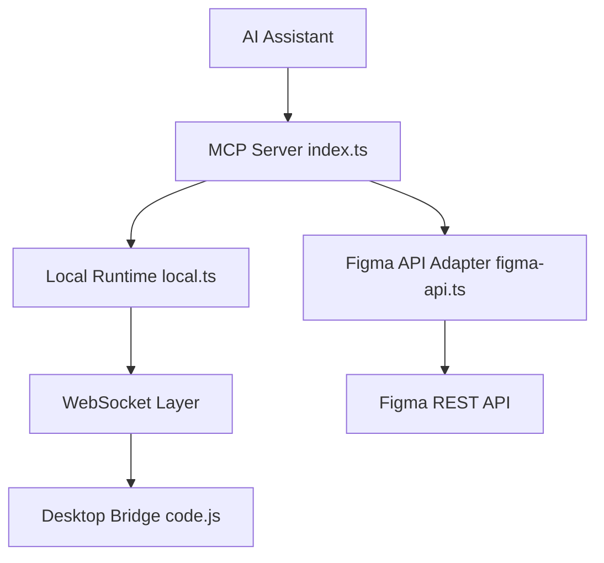

# southleft/figma-console-mcp

> Serveur MCP qui laisse un assistant IA lire et modifier Figma, synchroniser les tokens et auditer un design system.

## Le problème
Un assistant IA ne voit ni les variables, ni les composants, ni les états d'un fichier Figma, donc le code généré ignore le design system.

## Ce que ça fait vraiment
Environ 130 outils MCP : extraction de variables et composants, création de frames et de composants, synchronisation de tokens (DTCG et neuf autres formats), FigJam, Slides, animations, contrôles d'accessibilité, parité design-code, audit de santé. Un plugin Desktop Bridge dialogue en WebSocket avec Figma Desktop ; le mode Cloud passe par un relais.

## Comment c'est branché


## Essayer
```bash
claude mcp add figma-console -s user -e FIGMA_ACCESS_TOKEN=figd_YOUR_TOKEN_HERE -e ENABLE_MCP_APPS=true -- npx -y figma-console-mcp@latest
```

## Coût et pièges
Gratuit, MIT. Il faut un jeton d'accès personnel Figma, Figma Desktop et Node 18+. Le mode lecture seule (SSE) ne peut rien modifier. Les variables de l'API REST exigent un plan Enterprise ; le plugin les contourne.

## Ce que ce n'est pas
Pas un générateur de code : il fournit des données structurées à l'IA. Pas utilisable sans Figma. Le README est tronqué avant la fin de la liste des outils.

## Alternatives
Aucune alternative nommée dans le README, hors « Figma's own MCP » cité pour les couches de code.

## Pour toi
À ignorer : outil de designers et d'intégrateurs front, sans lien avec des pipelines data, IA ou MLOps.

