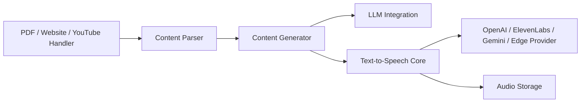

# souzatharsis/podcastfy

> Python library that turns web pages, PDFs, images or videos into a conversational podcast.

## The problem
Closed tools like NotebookLM allow neither customization, nor automation, nor generation at scale.

## What it actually does
Content extraction (websites, PDFs, YouTube, images) then dialogue generation by an LLM (100+ models, including local ones).
Speech synthesis via OpenAI, Google, ElevenLabs or Edge; short or long format (30 min+), multilingual.
Style, voices and structure configured through YAML.
Usable in Python, CLI or FastAPI API (beta).

## How it is wired


## Trying it
```bash
pip install podcastfy
python -m podcastfy.client --url <url1> --url <url2>
```

## Cost and gotchas
LLM and TTS keys at your expense (ElevenLabs can be expensive); ffmpeg required.
Audio quality depends on the TTS provider.

## What it is not
Not a finished product like NotebookLM with a polished interface.
Not an audio editing tool.

## Alternatives
- NotebookLM: Google's closed tool, for research synthesis through an interface.
- OpenNotebook, SurfSense: projects built on Podcastfy.

## For you
Worth watching: handy for turning docs or papers into audio; a one-person project but adopted by other tools.
