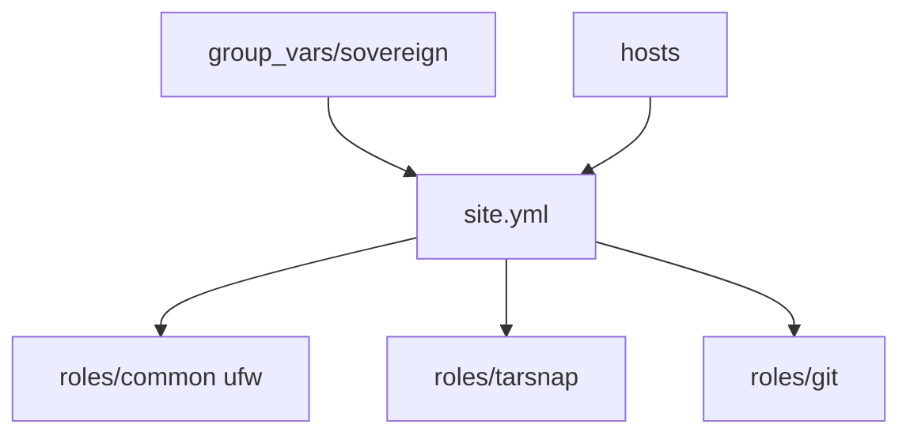

# sovereign/sovereign

> Ansible playbooks to set up your personal cloud (mail, calendar, files, VPN, git) on a VPS.

## The problem
Replacing Google Apps with your own free services, without installing and securing them one by one.

## What it actually does
Deploys on a Debian server: mail (Postfix, Dovecot, Rspamd, DKIM, DMARC), Roundcube webmail, ownCloud, XMPP, OpenVPN VPN, git, RSS, Wallabag, firewall, fail2ban and nightly Tarsnap backups. Each role can be disabled in `site.yml`.

## How it is wired


## Trying it
```bash
git clone https://github.com/sovereign/sovereign.git
ansible-playbook -i ./hosts --ask-sudo-pass site.yml
ansible-playbook -i ./hosts --tags=ufw site.yml
```

## Cost and gotchas
You need a VPS (512 MB of RAM minimum, 1 GB at the author's), a funded Tarsnap account, a domain and DNS records. Manual steps remain (DNS, ZNC, ownCloud, an EncFS volume to unlock at each reboot).

## What it is not
Not a one-click installation. The README targets Debian 8.3 and Ansible 1.9.3+; the last push dates from December 2022 and the license is not identified.

## Alternatives
No alternative named in the README.

## For you
Ignore: a dated personal mail and cloud hosting setup, unrelated to data, AI or MLOps, and not updated since 2022.
