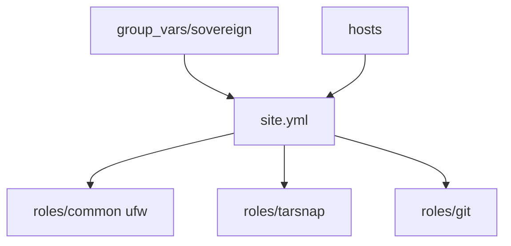

# sovereign/sovereign

> Playbooks Ansible pour monter son cloud personnel (mail, agenda, fichiers, VPN, git) sur un VPS.

## Le problème
Remplacer Google Apps par ses propres services libres, sans les installer et les sécuriser un par un.

## Ce que ça fait vraiment
Déploie sur un serveur Debian : mail (Postfix, Dovecot, Rspamd, DKIM, DMARC), webmail Roundcube, ownCloud, XMPP, VPN OpenVPN, git, RSS, Wallabag, pare-feu, fail2ban et sauvegardes nocturnes Tarsnap. Chaque rôle peut être désactivé dans `site.yml`.

## Comment c'est branché


## Essayer
```bash
git clone https://github.com/sovereign/sovereign.git
ansible-playbook -i ./hosts --ask-sudo-pass site.yml
ansible-playbook -i ./hosts --tags=ufw site.yml
```

## Coût et pièges
Il faut un VPS (512 Mo de RAM au minimum, 1 Go chez l'auteur), un compte Tarsnap crédité, un domaine et des enregistrements DNS. Des étapes manuelles restent (DNS, ZNC, ownCloud, volume EncFS à déverrouiller à chaque redémarrage).

## Ce que ce n'est pas
Pas une installation en un clic. Le README cible Debian 8.3 et Ansible 1.9.3+ ; le dernier push date de décembre 2022 et la licence n'est pas identifiée.

## Alternatives
Aucune alternative nommée dans le README.

## Pour toi
À ignorer : hébergement mail et cloud personnel daté, sans lien avec data, IA ou MLOps, et non mis à jour depuis 2022.

