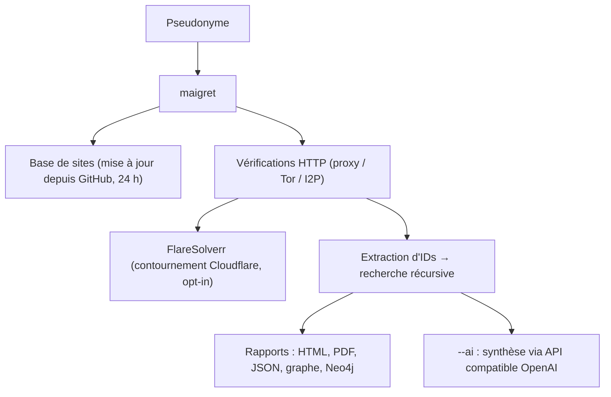

# soxoj/maigret

> OSINT tool that builds a profile of a person from a simple username.

## The problem
Finding the accounts tied to a username otherwise means hundreds of manual searches, site by site, with no cross-checking of the information found.

## What it actually does
Queries 5,900 sites; a default run covers the 500 top-ranked by traffic, `-a` extends to all, `--tags` filters by category or country. No API key is required.
Extracts from profile pages and APIs everything available about the account holder, including links to other accounts, then launches a recursive search on the identifiers found.
Detects and partially bypasses blocks, censorship and CAPTCHAs; works with Tor and I2P.
Produces reports in PDF, HTML, CSV, TXT, JSON, interactive D3 graph, XMind and Neo4j Cypher script.
Can be imported as a Python library, and offers a web interface and an `--ai` summary mode.

## How it is wired


## Trying it
```bash
pip install maigret
maigret YOUR_USERNAME
maigret user --html
maigret user --tags photo,dating
docker run -p 5000:5000 soxoj/maigret:web
export OPENAI_API_KEY=sk-... && maigret user --ai
```

## Cost and gotchas
Free, MIT, including for commercial use. Python 3.10 minimum. The `--ai` mode sends the internal report to an OpenAI-compatible API: key at your expense, and data sent to a third party. Cloudflare bypass is experimental and requires a local FlareSolverr. The public site database degrades over time; the daily-updated version is a paid service.

## What it is not
It is not legally neutral: the README reminds you that use is for educational and lawful purposes only, and that GDPR remains your responsibility. It is not exhaustive: detection breaks when sites change. The one-click deployable web instance has no authentication.

## Alternatives
No alternative named in the README.

## For you
Outside your field, except for defensive use: checking what a professional username reveals.
