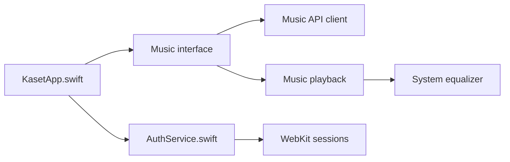

# sozercan/kaset

> Unofficial native macOS client for YouTube Music and YouTube, with equalizer and lyrics.

## The problem
YouTube Music has no real native macOS application integrated with the system.

## What it actually does
macOS application (15.4+) that plays YouTube Music (protected content via a Premium subscription) and YouTube with native controls. 6-band equalizer, synchronized lyrics, queue, smart shuffle, library, podcasts, shortcuts, AppleScript and a `kaset://` URL scheme. On-device AI features from macOS 26.

## How it is wired


## Trying it
```bash
brew install sozercan/repo/kaset
xattr -cr /Applications/Kaset.app
```

## Cost and gotchas
Free, but a Google account and a Premium subscription are needed for protected playback. The application is not signed.

## What it is not
Not a Google product: unaffiliated, it relies on the third-party service. macOS only.

## Alternatives
No alternative named in the README.

## For you
Ignore: consumer macOS application unrelated to data, AI or MLOps.
