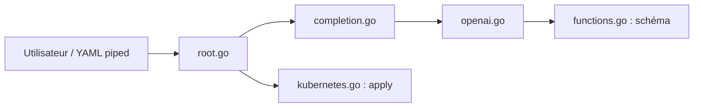

# sozercan/kubectl-ai

> kubectl plugin that generates and applies Kubernetes manifests from a sentence, via OpenAI.

## The problem
Writing a manifest to quickly test an idea forces you to hunt for scattered examples.

## What it actually does
Sends the request (and optional input YAML) to an OpenAI, Azure OpenAI or compatible model, displays the manifest, then offers Retry, Apply or Cancel. With `--use-k8s-api`, it consults the cluster's OpenAPI schema (CRDs included) through function calling. `--raw` mode for pipes.

## How it is wired


## Trying it
```bash
brew tap sozercan/kubectl-ai https://github.com/sozercan/kubectl-ai
brew install kubectl-ai
kubectl ai "create an nginx deployment with 3 replicas"
```

## Cost and gotchas
OpenAI key, Azure OpenAI or compatible endpoint (AIKit, LocalAI); schema mode uses more calls. Confirmation before applying is on by default.

## What it is not
Not aware of the cluster state: it always generates a complete manifest, as the README says. Last push in January 2025 and an old default model (`gpt-3.5-turbo-0301`).

## Alternatives
No alternative named in the README.

## For you
Ignore: poorly maintained, outdated default models and generation without knowledge of the cluster; always review a manifest before `apply`.
