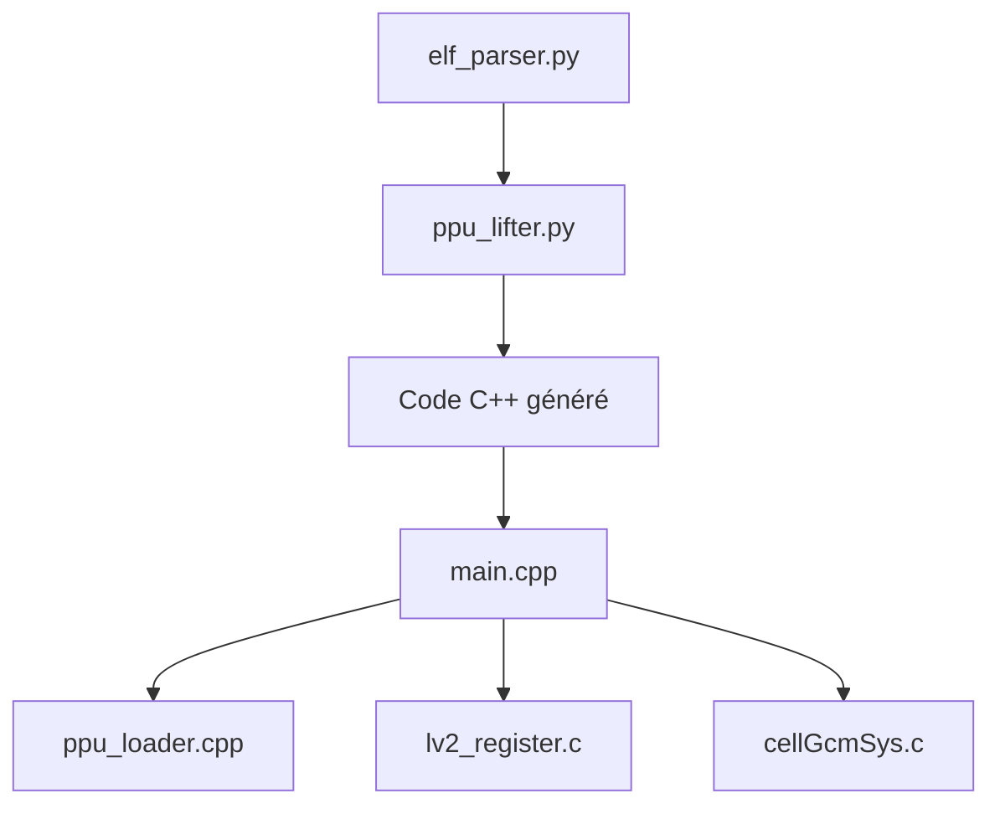

# sp00nznet/ps3recomp

> Toolkit for statically recompiling PlayStation 3 games into native executables, without an emulator.

## The problem
Emulators interpret PS3 code at runtime; ahead-of-time recompilation aims for better performance and a lasting port.

## What it actually does
A Python pipeline analyses PS3 binaries, disassembles PowerPC and SPU, then generates C++. A runtime provides system calls, HLE libraries and a graphics backend (D3D12, Metal, Vulkan). Several game ports are in progress; the README is truncated.

## How it is wired


## Trying it
```bash
python tools/ppu_loader.py /path/to/EBOOT.ELF -o out/
python tools/gen_hle_nids.py --all --out templates/project/recompiled/ppu_hle_nids.cpp
cd templates/project && cmake -B build -G Ninja && cmake --build build
```

## Cost and gotchas
Free, but you supply your own legally obtained game files. Python 3.10+, CMake 3.20+, Ninja and a C++20 compiler; clang-cl on Windows; SDL2 on Linux and macOS.

## What it is not
Not an emulator, nor a turnkey tool: each game requires a specific port.

## Alternatives
RPCS3, cited as the emulation reference.

## For you
Ignore: game reverse engineering unrelated to data, AI or MLOps work.
