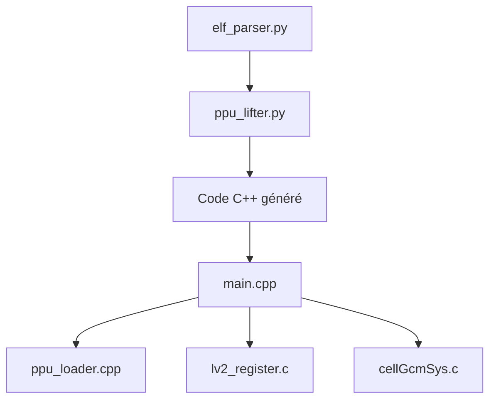

# sp00nznet/ps3recomp

> Boîte à outils de recompilation statique de jeux PlayStation 3 en exécutables natifs, sans émulateur.

## Le problème
Les émulateurs interprètent le code PS3 à l'exécution ; la recompilation anticipée vise de meilleures performances et un portage durable.

## Ce que ça fait vraiment
Un pipeline Python analyse les binaires PS3, désassemble PowerPC et SPU, puis génère du C++. Un runtime fournit appels système, bibliothèques HLE et backend graphique (D3D12, Metal, Vulkan). Plusieurs portages de jeux sont en cours ; le README est tronqué.

## Comment c'est branché


## Essayer
```bash
python tools/ppu_loader.py /path/to/EBOOT.ELF -o out/
python tools/gen_hle_nids.py --all --out templates/project/recompiled/ppu_hle_nids.cpp
cd templates/project && cmake -B build -G Ninja && cmake --build build
```

## Coût et pièges
Gratuit, mais tu fournis tes propres fichiers de jeu légalement obtenus. Python 3.10+, CMake 3.20+, Ninja et un compilateur C++20 ; clang-cl sous Windows ; SDL2 sous Linux et macOS.

## Ce que ce n'est pas
Pas un émulateur, ni un outil clé en main : chaque jeu demande un portage spécifique.

## Alternatives
RPCS3, cité comme référence d'émulation.

## Pour toi
À ignorer : rétro-ingénierie de jeux sans lien avec un travail data, IA ou MLOps.

