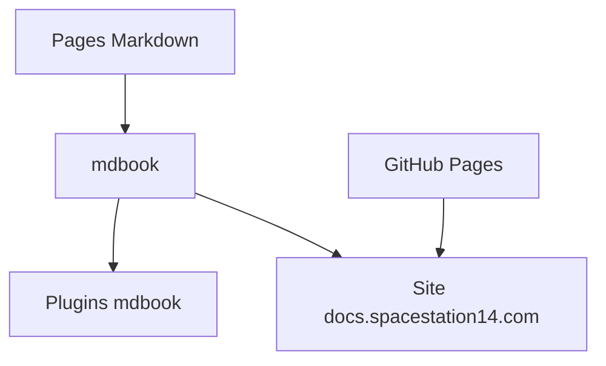

# space-wizards/docs

> The mdbook developer wiki for the Space Wizards projects (Space Station 14, Robust Toolbox engine), for contributors and fork creators.

## The problem
A community game with an engine, launcher and content needs a single documentation, editable by everyone, without login infrastructure.

## What it actually does
`mdbook` source of the docs.spacestation14.com site. Listed plugins: MathJax, mermaid, linkcheck, template, admonish, emojicodes, embedify. The pages cover mapping, sprites, contribution and engine usage. The editing guide is on the site itself.

## How it is wired
Simplified diagram based on the sheet, no diagram provided.


## Trying it
```bash
# Aucune commande documentée dans le README : voir le Guide to Editing Docs sur le site.
```

## Cost and gotchas
Free. The README defers build and test details to the editing guide: not documented here.

## What it is not
Not a tool nor a library: documentation for a video game. It does not serve as a ready-made generic wiki template.

## Alternatives
No alternative named in the README.

## For you
Ignore for a data / AI / MLOps profile: the content is about a game and its engine, unrelated to your pipelines; only the mdbook config may inspire a docs site.
