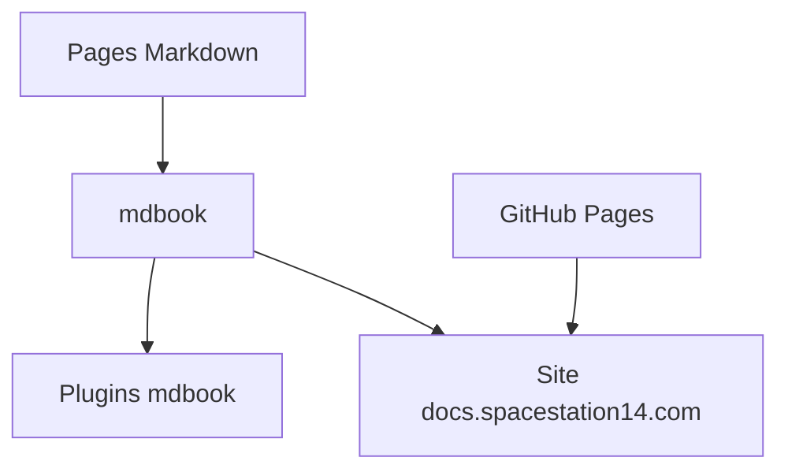

# space-wizards/docs

> Le wiki développeur mdbook des projets Space Wizards (Space Station 14, moteur Robust Toolbox), pour contributeurs et créateurs de forks.

## Le problème
Un jeu communautaire avec moteur, launcher et contenu a besoin d'une documentation unique, éditable par tous, sans infrastructure de connexion.

## Ce que ça fait vraiment
Source `mdbook` du site docs.spacestation14.com. Plugins listés : MathJax, mermaid, linkcheck, template, admonish, emojicodes, embedify. Les pages couvrent cartographie, sprites, contribution et usage du moteur. Le guide d'édition se trouve sur le site lui-même.

## Comment c'est branché
Schéma simplifié d'après la fiche, sans diagramme fourni.


## Essayer
```bash
# Aucune commande documentée dans le README : voir le Guide to Editing Docs sur le site.
```

## Coût et pièges
Gratuit. Le README renvoie le détail de build et de test au guide d'édition : non documenté ici.

## Ce que ce n'est pas
Pas un outil ni une bibliothèque : une documentation pour un jeu vidéo. Elle ne sert pas de modèle générique de wiki prêt à l'emploi.

## Alternatives
Aucune alternative nommée dans le README.

## Pour toi
À ignorer pour un profil data / IA / MLOps : le contenu porte sur un jeu et son moteur, sans lien avec tes pipelines ; seule la config mdbook peut inspirer un site de docs.

