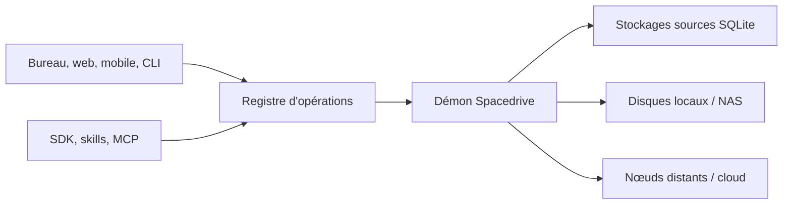

# spacedriveapp/spacedrive

> Unified, self-hosted personal file system: index, search and operations across your storage sources.

## The problem
Files are scattered across disks, NAS and clouds, with no shared search, no inventory of copies and no preview of what an operation will do.

## What it actually does
A Rust daemon handles file identity (BLAKE3), indexing, operations and durable jobs. Each source has a portable SQLite store with an FTS5 index. Every operation follows validation, preview, execution. Desktop, web, mobile, CLI, SDK and MCP clients call the same operations. Pairing between nodes via Iroh/QUIC. Source mounting, extensions.

## How it is wired


## Trying it
```bash
sd daemon install
sd config set update.channel nightly
sd update --yes
just dev-daemon
```
Nightly binaries (`sd`, `sd-daemon`) for macOS ARM64 and Linux x86-64.

## Cost and gotchas
Free, with no telemetry or account according to the README. Nightly builds are unsigned, may break and change schema without migration: back up any library. The 2.0 beta is announced for November 1, 2026. The code diagram provided describes an older architecture (Tauri, Prisma, rspc), contradicted by the README: trust the README.

## What it is not
Not an AI agent: the agent remains yours, via CLI or MCP. Not yet stable.

## Alternatives
No alternative named in the README.

## For you
Watch: the single pre-validated API for agents is a strong idea for delegating file operations, but wait for the beta before entrusting it with data.
