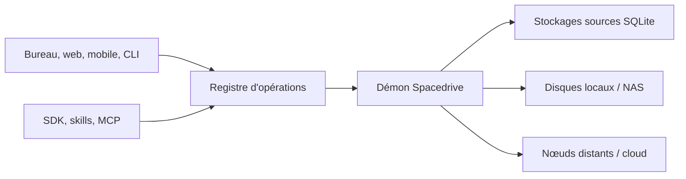

# spacedriveapp/spacedrive

> Système de fichiers personnel unifié et auto-hébergé : index, recherche et opérations sur tes sources de stockage.

## Le problème
Les fichiers sont éparpillés entre disques, NAS et clouds, sans recherche commune, sans inventaire des copies ni aperçu des effets d'une opération.

## Ce que ça fait vraiment
Un démon Rust gère l'identité des fichiers (BLAKE3), l'indexation, les opérations et les tâches durables. Chaque source a un magasin SQLite portable avec index FTS5. Toute opération suit validation, aperçu, exécution. Clients bureau, web, mobile, CLI, SDK, MCP appellent les mêmes opérations. Appairage entre nœuds via Iroh/QUIC. Montage de sources, extensions.

## Comment c'est branché


## Essayer
```bash
sd daemon install
sd config set update.channel nightly
sd update --yes
just dev-daemon
```
Binaires nightly (`sd`, `sd-daemon`) pour macOS ARM64 et Linux x86-64.

## Coût et pièges
Gratuit, sans télémétrie ni compte selon le README. Les builds nightly ne sont pas signés, peuvent casser et changer de schéma sans migration : sauvegarder toute bibliothèque. La bêta 2.0 est annoncée pour le 1er novembre 2026. Le diagramme du code fourni décrit une ancienne architecture (Tauri, Prisma, rspc), contredite par le README : se fier au README.

## Ce que ce n'est pas
Pas un agent IA : l'agent reste le tien, via CLI ou MCP. Pas encore stable.

## Alternatives
Aucune alternative nommée dans le README.

## Pour toi
Surveiller : l'API unique prévalidée pour agents est une idée forte pour déléguer des opérations de fichiers, mais attendre la bêta avant de lui confier des données.

