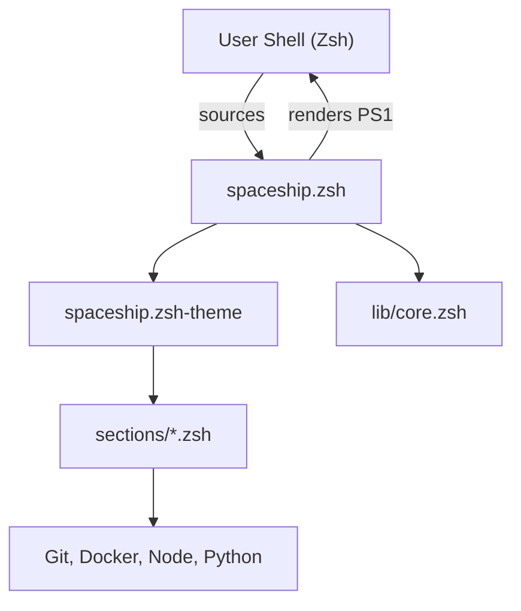

# spaceship-prompt/spaceship-prompt

> Zsh prompt theme that displays Git, runtimes, Docker and Kubernetes, for those who live in the terminal.

## The problem
A bare prompt says nothing about the Git repo, the active Node or Python version, or the Kubernetes context. You have to type commands to find out.

## What it actually does
`spaceship.zsh` loads the modules in `lib/`, then calls each section in `sections/` (git, docker, node, python…). Each section queries an external CLI or the environment, and the result is assembled into the PS1 on every display. Configuration goes through zstyle and environment variables.

## How it is wired


## Trying it
```zsh
brew install spaceship
echo "source $(brew --prefix)/opt/spaceship/spaceship.zsh" >>! ~/.zshrc
npm install -g spaceship-prompt
```

## Cost and gotchas
Free. Requires Zsh 5.2 or later and a Powerline or Nerd Font in the terminal, otherwise glyphs are broken. There are many installation methods depending on the plugin manager.

## What it is not
Not a data or AI tool. The README itself cites starship as an alternative inspired by it. Sections launch external CLIs on every prompt: the cost depends on them.

## Alternatives
- starship/starship: multi-shell prompt written in Rust, inspired by Spaceship.
- matchai/spacefish: port of Spaceship for fish.

## For you
Ignore for the watch: it is terminal comfort, unrelated to data, AI or MLOps. Take it only if you are looking for a Zsh prompt.
