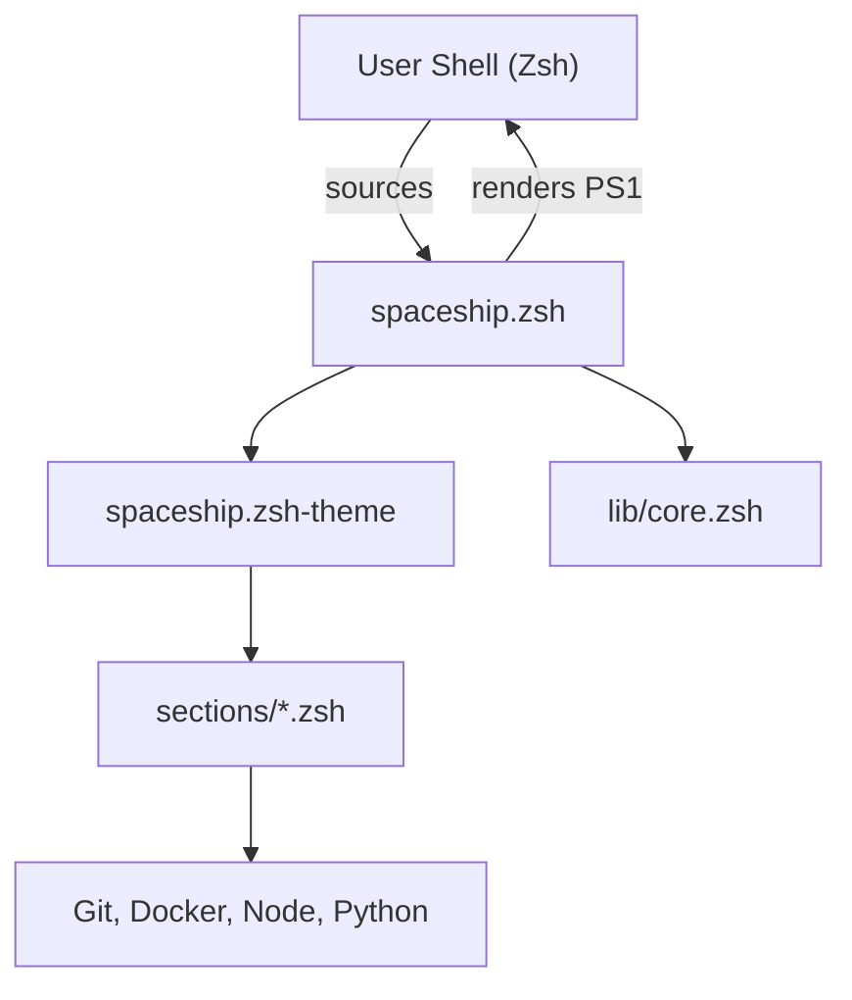

# spaceship-prompt/spaceship-prompt

> Thème de prompt Zsh qui affiche Git, runtimes, Docker et Kubernetes, pour qui vit dans le terminal.

## Le problème
Un prompt nu ne dit rien du dépôt Git, de la version de Node ou Python active, ni du contexte Kubernetes. On tape des commandes pour le savoir.

## Ce que ça fait vraiment
`spaceship.zsh` charge les modules de `lib/`, puis appelle chaque section de `sections/` (git, docker, node, python…). Chaque section interroge une CLI externe ou l'environnement, et le résultat est assemblé dans le PS1 à chaque affichage. La configuration passe par zstyle et des variables d'environnement.

## Comment c'est branché


## Essayer
```zsh
brew install spaceship
echo "source $(brew --prefix)/opt/spaceship/spaceship.zsh" >>! ~/.zshrc
npm install -g spaceship-prompt
```

## Coût et pièges
Gratuit. Exige Zsh 5.2 ou plus et une police Powerline ou Nerd Font dans le terminal, sinon les glyphes sont cassés. Il existe de nombreuses méthodes d'installation selon le gestionnaire de plugins.

## Ce que ce n'est pas
Ce n'est pas un outil data ou IA. Le README cite lui-même starship comme alternative inspirée de lui. Les sections lancent des CLI externes à chaque prompt : le coût dépend d'elles.

## Alternatives
- starship/starship : prompt multi-shells écrit en Rust, inspiré de Spaceship.
- matchai/spacefish : port de Spaceship pour fish.

## Pour toi
Ignorer pour la veille : c'est du confort de terminal, sans lien avec la donnée, l'IA ou le MLOps. À prendre seulement si tu cherches un prompt Zsh.

