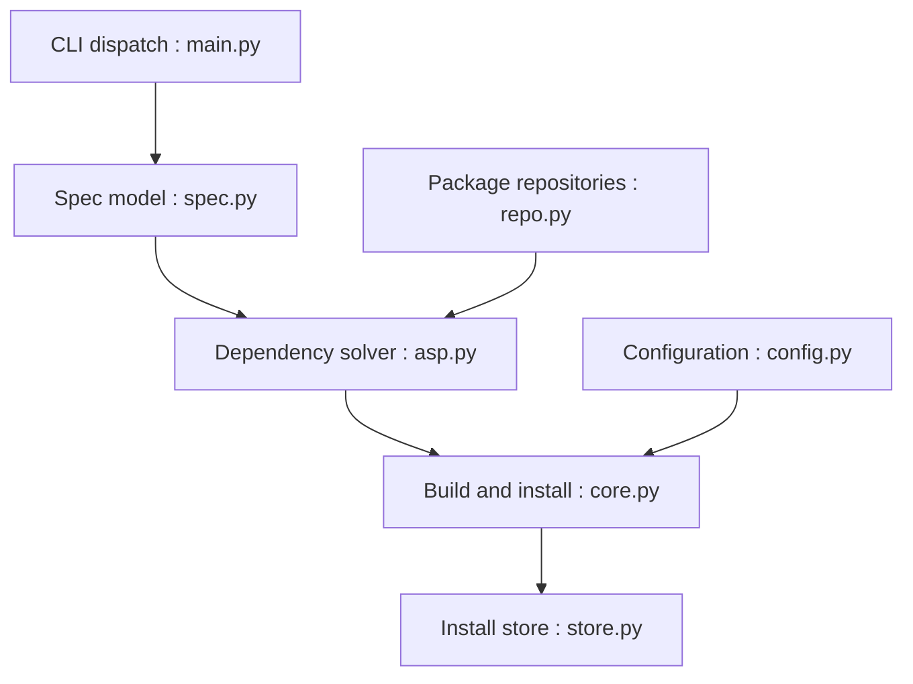

# spack/spack

> Cross-platform package manager that builds multiple versions and configurations of a piece of software, designed for high-performance computing.

## The problem
On supercomputers, the same software must exist in several versions, compilers and options without breaking existing installations.

## What it actually does
A "spec" syntax describes version and options. Spack resolves dependencies, builds and installs into a non-destructive store where several configurations coexist. Recipes are written in Python. It runs on Linux, macOS, Windows and on supercomputers.

## How it is wired


## Trying it
```bash
git clone --depth=2 https://github.com/spack/spack.git
. spack/share/spack/setup-env.sh
spack install zlib-ng
spack help --all
```

## Cost and gotchas
Free. Python and Git required. Builds from source can be long; the README mentions binary caches without detailing their use here. 1,804 open issues.

## What it is not
Not a Python package manager like pip: it builds native software. Community recipes live in another repository (spack-packages).

## Alternatives
- spack/spack-packages: this is where recipes are contributed, not in this repository.

## For you
Worth watching: relevant if you manage reproducible HPC or GPU environments; superfluous if Docker and conda are enough for you.
