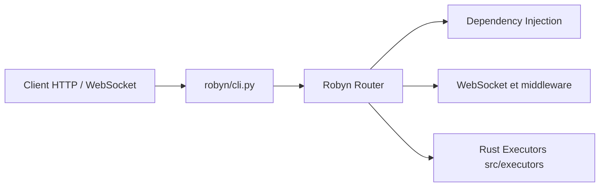

# sparckles/Robyn

> Python web framework with a Rust runtime for building asynchronous APIs, for backend developers.

## The problem
Classic Python web frameworks plateau in throughput; you want a simple Python API with a faster core.

## What it actually does
HTTP server whose runtime is in Rust, driven from Python: dynamic routing, WebSockets, middlewares, dependency injection, automatically generated OpenAPI, SSE, static files, Jinja2, CLI scaffolding. The README also announces support for AI agents and MCP, without detail.

## How it is wired


## Trying it
```bash
pip install robyn
```
```python
from robyn import Robyn

app = Robyn(__file__)

@app.get("/")
async def h(request):
    return "Hello, world!"

app.start(port=8080)
```
```bash
python3 app.py
```

## Cost and gotchas
Free. To contribute, you need Python 3.10 to 3.14, stable Rust and a C compiler (maturin). io-uring support is marked experimental.

## What it is not
Not a "batteries included" framework: data access goes through scaffolding templates (SQLAlchemy, Prisma, Mongo...), not a built-in ORM. The TechEmpower ranking cited is the author's own.

## Alternatives
No alternative named in the README.

## For you
Worth watching: relevant if you expose models behind an API and latency matters, but nothing in the README proves it does better than your current stack for your case.
