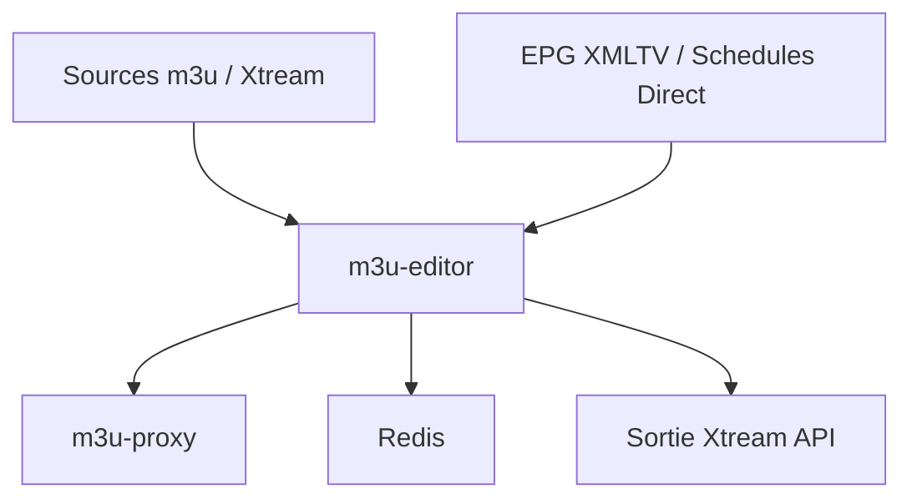

# sparkison/m3u-editor

> Self-hosted IPTV editor for m3u playlists, EPG guides and Xtream API output, in the vein of xteve or threadfin.

## The problem
Managing channel m3u lists, their EPG guides and their series by hand is tedious.

## What it actually does
Imports m3u, m3u8 and Xtream codes, manages the EPG (XMLTV, Schedules Direct), exposes an Xtream API output, synchronizes `.strm` files for series and runs scripts, webhooks or emails after processing. Deployed in containers, with an external proxy for hardware acceleration.

## How it is wired
Simplified diagram based on the sheet, no diagram provided.

## Trying it
Commands are not given, only deployment files: `docker-compose.proxy.yml` (recommended) or `docker-compose.aio.yml`. Default credentials: admin / admin, port 36400.

## Cost and gotchas
Free when self-hosted; paid managed hosting at ElfHosted. CC BY-NC-SA license cited in the README, not identified by GitHub: commercial use restricted. Change the default password.

## What it is not
Not a stream provider: you need your own sources. No link with data work.

## Alternatives
- xteve and threadfin: similar tools mentioned in the README.

## For you
Ignore: personal IPTV stream management, unrelated to a data / AI / MLOps job.
