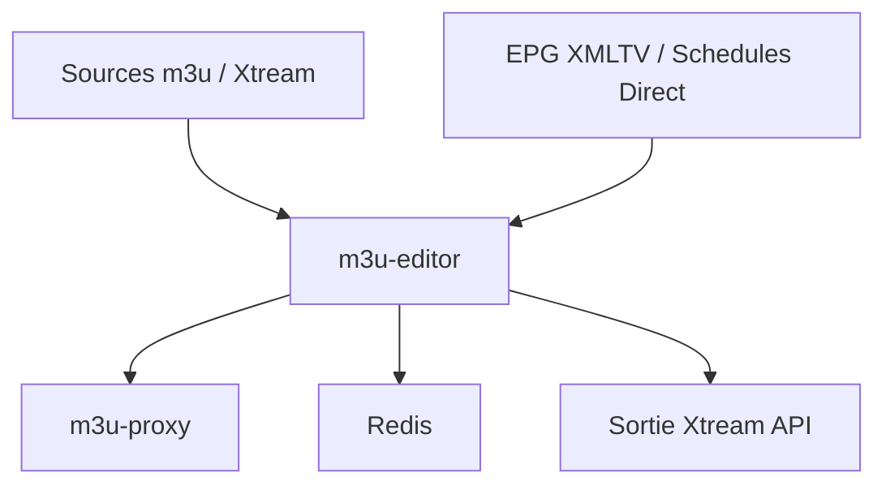

# sparkison/m3u-editor

> Éditeur IPTV auto-hébergé pour listes m3u, guides EPG et sortie Xtream API, type xteve ou threadfin.

## Le problème
Gérer des listes de chaînes m3u, leurs guides EPG et leurs séries à la main est pénible.

## Ce que ça fait vraiment
Importe m3u, m3u8 et Xtream codes, gère l'EPG (XMLTV, Schedules Direct), expose une sortie Xtream API, synchronise des fichiers `.strm` pour les séries et exécute des scripts, webhooks ou courriels après traitement. Se déploie en conteneurs, avec un proxy externe pour l'accélération matérielle.

## Comment c'est branché
Schéma simplifié d'après la fiche, sans diagramme fourni.

## Essayer
Les commandes ne sont pas données, seulement les fichiers de déploiement : `docker-compose.proxy.yml` (recommandé) ou `docker-compose.aio.yml`. Identifiants par défaut : admin / admin, port 36400.

## Coût et pièges
Gratuit en auto-hébergement ; hébergement géré payant chez ElfHosted. Licence CC BY-NC-SA citée dans le README, non identifiée par GitHub : usage commercial restreint. Changer le mot de passe par défaut.

## Ce que ce n'est pas
Pas un fournisseur de flux : il faut tes propres sources. Aucun lien avec un travail data.

## Alternatives
- xteve et threadfin : outils semblables cités dans le README.

## Pour toi
À ignorer : gestion de flux IPTV personnelle, sans rapport avec un métier data / IA / MLOps.

