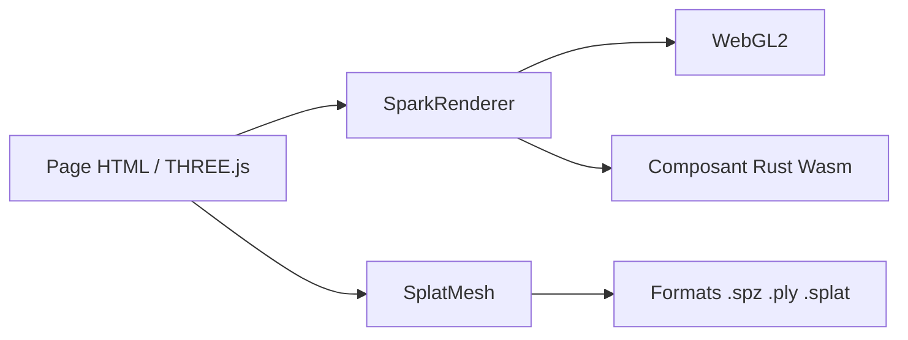

# sparkjsdev/spark

> 3D Gaussian Splatting rendering engine for THREE.js, for web and graphics developers.

## The problem
Displaying Gaussian Splatting scenes in a browser, mixed with classic meshes, requires a separate and heavy rendering pipeline.

## What it actually does
Integrates into the THREE.js pipeline to mix splats and meshes with correct sorting. Reads the .PLY, .SPZ, .SPLAT, .KSPLAT and .SOG formats, renders multiple viewpoints, and allows editing colors, displacements and skeletal animation. A shader graph system creates splats on the GPU. The Wasm component is written in Rust. Developed by World Labs.

## How it is wired
Simplified diagram based on the write-up, no diagram provided.


## Trying it
```bash
npm install @sparkjsdev/spark
npm install
npm run build:wasm
npm run build
npm start
```

## Cost and gotchas
Free. Building from source requires Rust for the Wasm. The examples load remote assets, which `npm run assets:download` caches locally.

## What it is not
Not a tool for training or capturing splats: it only displays and edits. It builds on THREE.js.

## Alternatives
No alternative named in the README.

## For you
Worth watching: useful for viewing 3D reconstructions (NeRF, splats) in the browser, outside the data / MLOps core.
