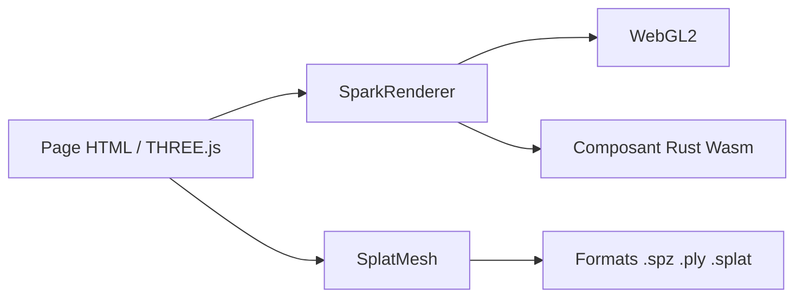

# sparkjsdev/spark

> Moteur de rendu de Gaussian Splatting 3D pour THREE.js, pour développeurs web et graphique.

## Le problème
Afficher des scènes en Gaussian Splatting dans un navigateur, mêlées à des maillages classiques, demande un rendu à part et lourd.

## Ce que ça fait vraiment
S'intègre au pipeline de THREE.js pour mélanger splats et maillages avec un tri correct. Lit les formats .PLY, .SPZ, .SPLAT, .KSPLAT et .SOG, rend plusieurs points de vue, et permet d'éditer couleurs, déplacements et animation squelettique. Un système de graphes de shaders crée des splats sur le GPU. Le composant Wasm est écrit en Rust. Développé par World Labs.

## Comment c'est branché
Schéma simplifié d'après la fiche, sans diagramme fourni.


## Essayer
```bash
npm install @sparkjsdev/spark
npm install
npm run build:wasm
npm run build
npm start
```

## Coût et pièges
Gratuit. Construire depuis les sources exige Rust pour le Wasm. Les exemples chargent des assets distants, que `npm run assets:download` met en cache local.

## Ce que ce n'est pas
Pas un outil d'entraînement ni de capture de splats : il ne fait qu'afficher et éditer. Il s'appuie sur THREE.js.

## Alternatives
Aucune alternative nommée dans le README.

## Pour toi
À surveiller : utile pour visualiser des reconstructions 3D (NeRF, splats) dans le navigateur, hors du cœur data / MLOps.

