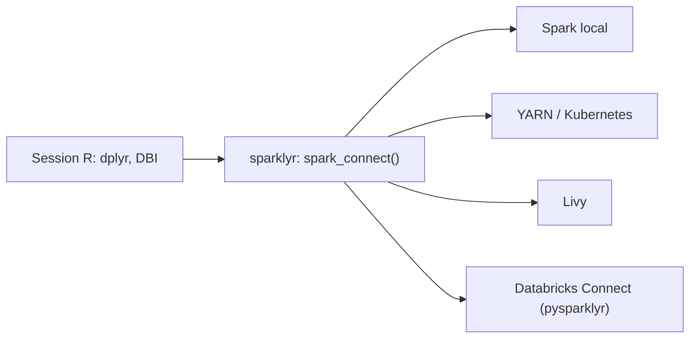

# sparklyr/sparklyr

> R interface for Apache Spark: dplyr, SQL, machine learning and distributed R on a cluster.

## The problem
The data exceeds the memory of an R session; you need a Spark cluster without leaving your R code.

## What it actually does
Connects to Spark locally, YARN, Mesos, Livy, Kubernetes or Databricks Connect. dplyr verbs and SQL queries (via DBI) are translated for Spark. It offers ML algorithms, CSV, JSON and Parquet reading and writing, `spark_apply()` for distributed R, extensions and an RStudio pane.

## How it is wired
Simplified diagram based on the sheet, no diagram provided.



## Trying it
```r
install.packages("sparklyr")
library(sparklyr)
spark_install()
sc <- spark_connect(master = "local")
```

## Cost and gotchas
Free; you need Spark (installed by `spark_install()`) and Java. Connections via Livy are, according to the README, much slower than the others.

## What it is not
Not an alternative to Spark or PySpark: it is an R layer. Mostly useful if your team works in R.

## Alternatives
- Apache Livy: go through a REST API rather than a direct connection.
- pysparklyr: connection to Databricks Connect v2.

## For you
Adopt if you do R on Spark: an old project, with recent activity and a clear license; otherwise PySpark remains the natural choice.
