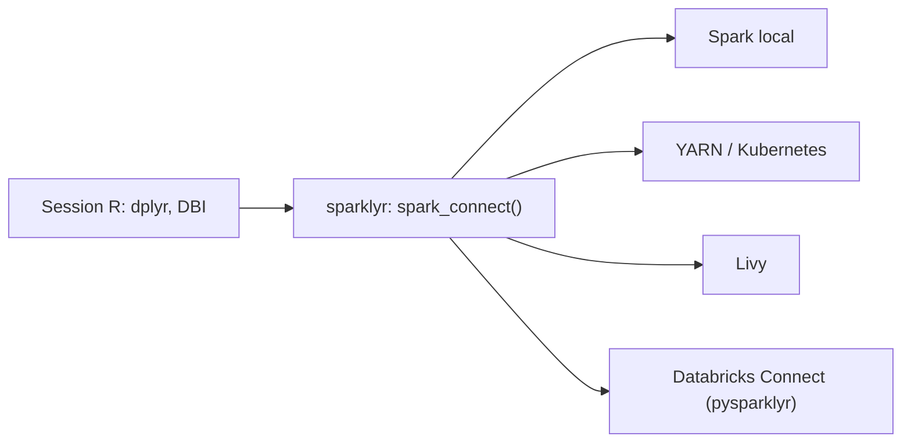

# sparklyr/sparklyr

> Interface R pour Apache Spark : dplyr, SQL, machine learning et R distribué sur un cluster.

## Le problème
Les données dépassent la mémoire d'une session R ; il faut un cluster Spark sans quitter son code R.

## Ce que ça fait vraiment
Connexion à Spark en local, YARN, Mesos, Livy, Kubernetes ou Databricks Connect. Les verbes dplyr et les requêtes SQL (via DBI) sont traduits pour Spark. Il propose des algorithmes ML, la lecture et l'écriture CSV, JSON, Parquet, `spark_apply()` pour du R distribué, des extensions et un volet RStudio.

## Comment c'est branché
Schéma simplifié d'après la fiche, sans diagramme fourni.



## Essayer
```r
install.packages("sparklyr")
library(sparklyr)
spark_install()
sc <- spark_connect(master = "local")
```

## Coût et pièges
Gratuit ; il faut Spark (installé par `spark_install()`) et Java. Les connexions via Livy sont, selon le README, bien plus lentes que les autres.

## Ce que ce n'est pas
Pas une alternative à Spark ni à PySpark : c'est une couche R. Utile surtout si ton équipe travaille en R.

## Alternatives
- Apache Livy : passer par une API REST plutôt qu'une connexion directe.
- pysparklyr : connexion à Databricks Connect v2.

## Pour toi
Adopter si tu fais du R sur Spark : projet ancien, activité récente et licence claire ; sinon PySpark reste le choix naturel.

