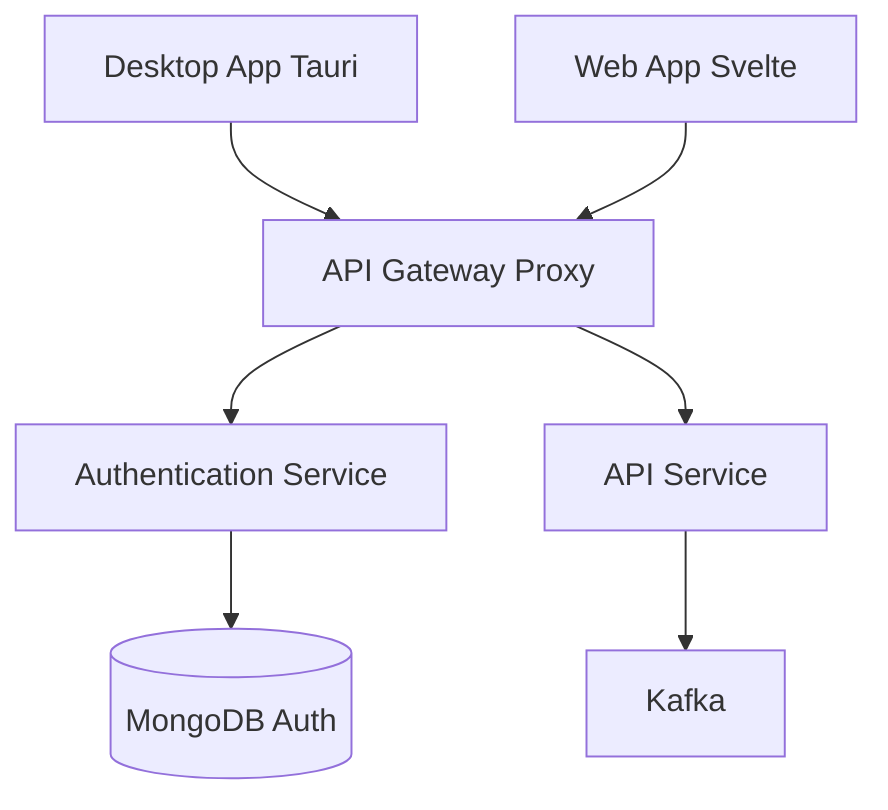

# sparrowapp-dev/sparrow-app

> Desktop and web API testing and management client, for developers who collaborate.

## The problem
Testing, debugging and sharing APIs with your team without stacking several tools.

## What it actually does
A Yarn monorepo with a desktop client (Tauri, Rust, Svelte), a web client and a Storybook. The authentication, API and proxy services live in other repositories, launched here via Docker Compose with MongoDB. The generated architecture diagram mentions Mixpanel and Canny on the client side.

## How it is wired


## Trying it
```bash
git clone https://github.com/sparrowapp-dev/sparrow-app
cd sparrow-app
yarn
yarn docker:up
yarn desktop-start
```

## Cost and gotchas
Free, but needs Node, Yarn, Rust and optionally Docker. The README gives a default account (dev@sparrow.com, password 12345678@): change it. AGPL-3.0: network copyleft. 250 open issues.

## What it is not
Not an automated testing or monitoring tool: a manual API client.

## Alternatives
No alternative named in the README.

## For you
Ignore: you call your APIs from code or notebooks, and the AGPL and the Mongo-Kafka stack are heavy for a simple client.
