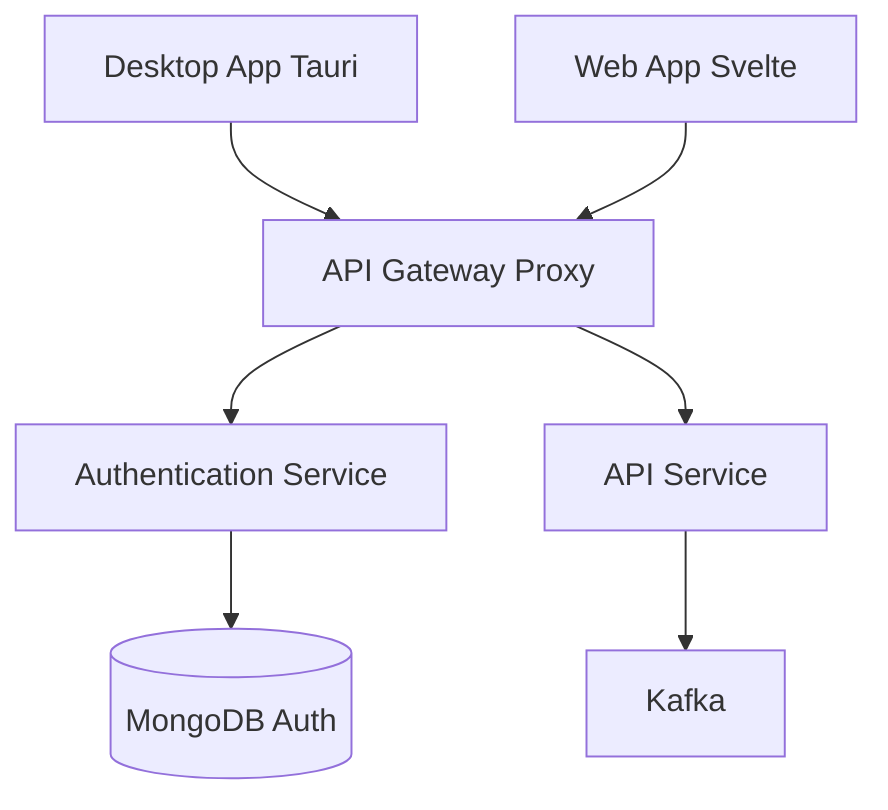

# sparrowapp-dev/sparrow-app

> Client de test et de gestion d'API, de bureau et web, pour développeurs qui collaborent.

## Le problème
Tester, déboguer et partager des API avec son équipe sans empiler plusieurs outils.

## Ce que ça fait vraiment
Un monorepo Yarn avec un client de bureau (Tauri, Rust, Svelte), un client web et un Storybook. Les services d'authentification, d'API et de proxy vivent dans d'autres dépôts, lancés ici par Docker Compose avec MongoDB. Le schéma d'architecture, généré, cite Mixpanel et Canny côté clients.

## Comment c'est branché


## Essayer
```bash
git clone https://github.com/sparrowapp-dev/sparrow-app
cd sparrow-app
yarn
yarn docker:up
yarn desktop-start
```

## Coût et pièges
Gratuit, mais il faut Node, Yarn, Rust et Docker en option. Le README donne un compte par défaut (dev@sparrow.com, mot de passe 12345678@) : à changer. AGPL-3.0 : copyleft réseau. 250 issues ouvertes.

## Ce que ce n'est pas
Pas un outil de test automatisé ni de supervision : un client manuel d'API.

## Alternatives
Aucune alternative nommée dans le README.

## Pour toi
À ignorer : tu tapes tes API depuis du code ou des notebooks, et l'AGPL et la pile Mongo-Kafka pèsent pour un simple client.

