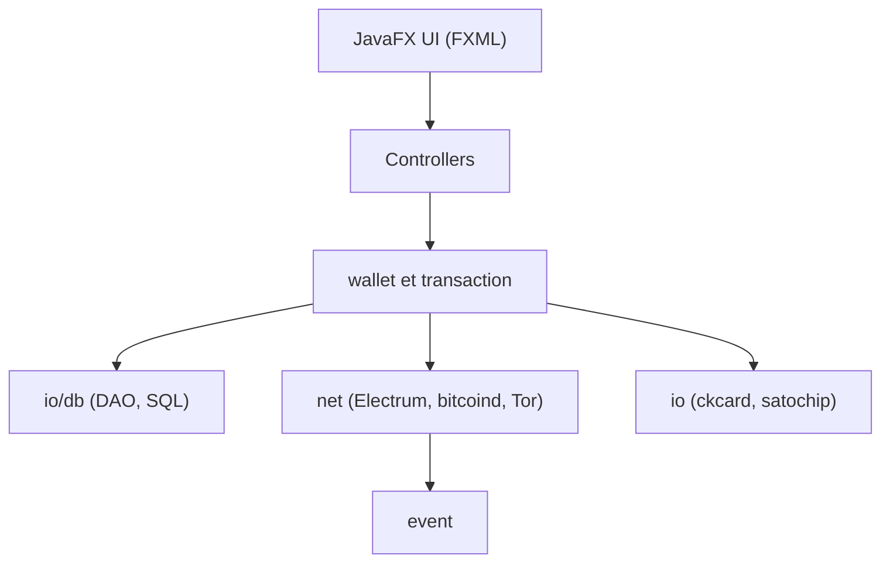

# sparrowwallet/sparrow

> Desktop Bitcoin wallet compatible with PSBT and hardware wallets, centered on transparency.

## The problem
Managing bitcoins with a hardware wallet requires software that exposes transaction details and does not depend on a third-party service.

## What it actually does
JavaFX application that supports most hardware wallets (including ckcard and Satochip), connects to a Bitcoin Core node or an Electrum server, optionally over Tor. SQL databases for wallets, an event system, mainnet, testnet, regtest and signet networks. Reproducible binaries since v1.5.0, signed with GPG.

## How it is wired


## Trying it
```bash
git clone --recursive https://github.com/sparrowwallet/sparrow.git
cd sparrow
./gradlew jpackage
./sparrow
./sparrow -h
```

## Cost and gotchas
Free. Building requires Java 25 or later (Temurin 25.0.5 for official releases); Windows requires WiX for the installer. It handles real funds: verify the signature and reproducibility of the binaries.

## What it is not
Not a mobile wallet nor a hosted service. Not a trading tool.

## Alternatives
No alternative named in the README.

## For you
Ignore: Bitcoin wallet, unrelated to data/AI/MLOps work.
