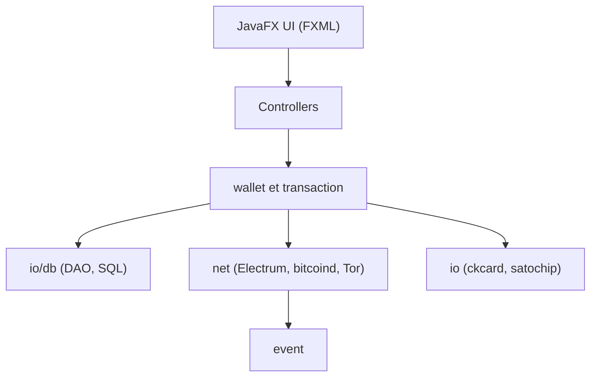

# sparrowwallet/sparrow

> Portefeuille Bitcoin de bureau compatible PSBT et portefeuilles matériels, centré sur la transparence.

## Le problème
Gérer des bitcoins avec un portefeuille matériel demande un logiciel qui expose les détails des transactions et ne dépend pas d'un service tiers.

## Ce que ça fait vraiment
Application JavaFX qui prend en charge la plupart des portefeuilles matériels (dont ckcard et Satochip), se connecte à un nœud Bitcoin Core ou à un serveur Electrum, éventuellement via Tor. Bases SQL pour les portefeuilles, système d'événements, réseaux mainnet, testnet, regtest, signet. Binaires reproductibles depuis la v1.5.0 et signés par GPG.

## Comment c'est branché


## Essayer
```bash
git clone --recursive https://github.com/sparrowwallet/sparrow.git
cd sparrow
./gradlew jpackage
./sparrow
./sparrow -h
```

## Coût et pièges
Gratuit. Compilation avec Java 25 ou plus (Temurin 25.0.5 pour les versions officielles) ; Windows demande WiX pour l'installateur. Il manipule des fonds réels : vérifier signature et reproductibilité des binaires.

## Ce que ce n'est pas
Pas un portefeuille mobile ni un service hébergé. Pas un outil de trading.

## Alternatives
Aucune alternative nommée dans le README.

## Pour toi
À ignorer : portefeuille Bitcoin, sans rapport avec le travail data/IA/MLOps.

