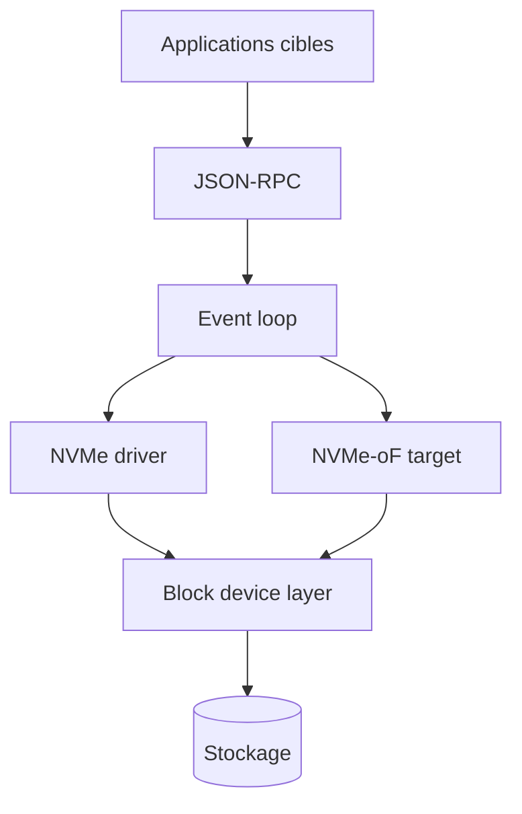

# spdk/spdk

> Tools and libraries for writing user-space storage applications, using polling rather than interrupts.

## The problem
The kernel and its interrupts add context switches that limit the throughput of fast NVMe disks.

## What it actually does
- User-space drivers: NVMe, I/OAT, Virtio-SCSI.
- NVMe over Fabrics, iSCSI and vhost targets (`nvmf_tgt`, `iscsi_tgt`, `vhost`, `spdk_tgt`).
- "Polled" mode: cores permanently show 100% CPU.
- Python bindings and examples provided.

## How it is wired


## Trying it
```bash
git clone https://github.com/spdk/spdk
cd spdk
git submodule update --init
./scripts/pkgdep.sh
./configure
make
sudo scripts/setup.sh
```

## Cost and gotchas
Free, but requires root, hugepages and detaching the NVMe disks from the kernel. Build with DPDK as a submodule. License present but not identified by GitHub.

## What it is not
Not a file system or a consumer tool: a kit for building storage. Usual tools like `top` lose their usefulness.

## Alternatives
No alternative named in the README.

## For you
Worth watching: only if you operate high-performance NVMe storage for large training runs; otherwise out of reach.
