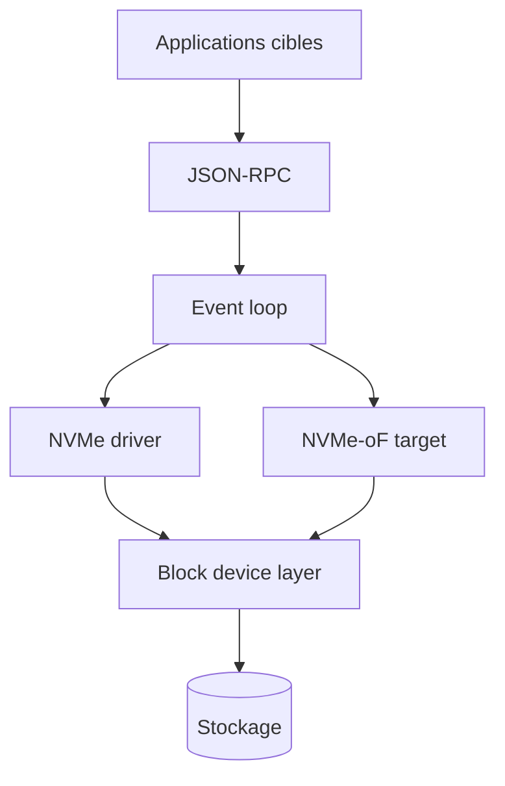

# spdk/spdk

> Outils et bibliothèques pour écrire des applications de stockage en espace utilisateur, par interrogation plutôt que par interruptions.

## Le problème
Le noyau et ses interruptions ajoutent des changements de contexte qui limitent le débit des disques NVMe rapides.

## Ce que ça fait vraiment
- Pilotes en espace utilisateur : NVMe, I/OAT, Virtio-SCSI.
- Cibles NVMe over Fabrics, iSCSI et vhost (`nvmf_tgt`, `iscsi_tgt`, `vhost`, `spdk_tgt`).
- Mode « polled » : les cœurs affichent 100 % de CPU en permanence.
- Liaisons Python et exemples fournis.

## Comment c'est branché


## Essayer
```bash
git clone https://github.com/spdk/spdk
cd spdk
git submodule update --init
./scripts/pkgdep.sh
./configure
make
sudo scripts/setup.sh
```

## Coût et pièges
Gratuit, mais exige root, des hugepages et de détacher les disques NVMe du noyau. Compilation avec DPDK en sous-module. Licence présente mais non identifiée par GitHub.

## Ce que ce n'est pas
Pas un système de fichiers ni un outil grand public : un kit pour construire du stockage. Les outils habituels comme `top` perdent leur utilité.

## Alternatives
Aucune alternative nommée dans le README.

## Pour toi
À surveiller : seulement si tu opères du stockage NVMe haute performance pour de gros entraînements ; sinon hors de portée.

